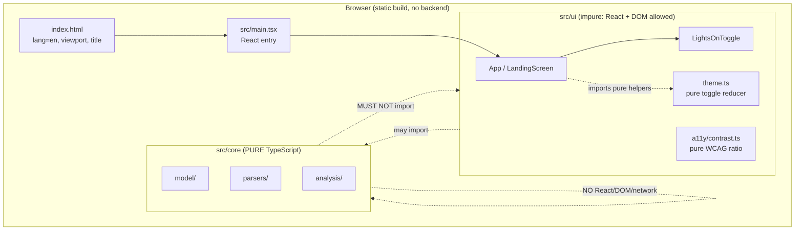

# Design Document

## Overview

Module 0: Foundation establishes the project base for Ledger Mortis: a client-side-only
Vite + React + TypeScript (strict) application that builds to static assets only. This module
delivers the scaffold, the canonical folder layout, the testing/linting/formatting toolchain,
a minimal landing screen built from the design tokens, and a skeleton README. It deliberately
ships none of the later-module behavior (parsing, analysis, graveyard visuals, import, exorcism).

The design is shaped by four binding constraints from the steering documents:

1. **Privacy is non-negotiable.** User transaction data never leaves the browser. There is no
   backend, no analytics, and no third-party script that sees user data. In Module 0 there is no
   user data yet, but the architecture and lint rules that *guarantee* this are put in place now.
2. **`src/core` is pure TypeScript.** No React, no DOM, no network. This boundary is enforced
   mechanically by ESLint so it cannot silently rot. (steering: `tech.md`, `privacy.md`)
3. **Readable first, spooky second.** The landing screen must meet WCAG AA contrast on both the
   ink and fog surfaces, and the implementation must *compute and verify* contrast rather than
   assume it. (steering: `design-language.md`)
4. **Money is integer minor units with explicit currency.** No floats. Documented now so every
   later module inherits the convention. (steering: `tech.md`)

### Design goals

- A single `npm run lint` / `npm test` / `npm run build` triad gates completion with zero tolerance
  for warnings (`--max-warnings 0`).
- The purity boundary is proven by construction: a violating file fails `npm run lint`.
- The property-based testing toolchain (fast-check) is proven to run end to end before any real
  business logic exists.
- The landing screen demonstrates the visual identity and the Lights-On plain-data mode stub while
  remaining fully keyboard-operable and contrast-verified.

### Out of scope (explicitly not designed here)

Parsers, analysis, graveyard visuals, import flows, exorcism flows, persistence/`localStorage`,
sample data content, and any Module 1+ feature. The folders for these exist (with `.gitkeep`) but
contain no implementation.

## Architecture

### Layered architecture



Key rules captured by the diagram:

- **Dependency direction is one-way.** `src/ui` may import from `src/core`; `src/core` must never
  import from `src/ui`, React, or React-DOM, and must never touch DOM or network globals.
- **No network anywhere in `src`.** `fetch`, `XMLHttpRequest`, `WebSocket`, and
  `navigator.sendBeacon` are forbidden across the whole `src` tree (Req 4.3), which is the
  mechanical guarantee behind the "data never leaves the browser" privacy rule.
- The build is static: Vite emits HTML/CSS/JS to `dist/`; there is no server runtime (Req 2.3).

### Build and runtime model

- **Dev:** `vite` serves the app with HMR (Req 7.1, 12.4).
- **Build:** `tsc -b` (type-check, Req 7.3) runs, then `vite build` emits static assets to `dist/`
  (Req 2.3, 7.2, 12.3).
- **No third-party scripts.** `index.html` references only local module entry points; fonts/assets
  are self-hosted (Req 2.4). Module 0 ships no external fonts, so this is trivially satisfied and
  the README records the rule.

### Why the core/ui split is enforced by lint, not convention

The steering docs make core purity a hard requirement, and later modules will put real financial
logic in `src/core`. A convention that "core shouldn't import React" degrades over time. Encoding
it as ESLint rules that fail the build (Req 4.1-4.4, 12.1) makes the boundary self-defending. The
rules are scoped with ESLint `overrides` so `src/core` gets the strict set and the rest of `src`
gets the network-only subset.

## Components and Interfaces

### Repository layout (after Module 0)

```
ledger-mortis/
├─ LICENSE                      # preserved, unchanged (Req 1.1)
├─ README.md                    # skeleton (Req 11)
├─ .gitignore                   # append-only edit (Req 1.4-1.6)
├─ package.json                 # scripts + engines (Req 7)
├─ tsconfig.json                # strict (Req 2.2)
├─ tsconfig.node.json           # for vite config type-checking
├─ vite.config.ts               # Vitest config lives here too
├─ eslint.config.js             # flat config with core overrides (Req 4, 6)
├─ .prettierrc.json             # formatter config (Req 6.2)
├─ index.html                   # lang/viewport/title (Req 9.6)
├─ .kiro/                       # preserved; never ignored (Req 1.2, 1.5)
│  ├─ steering/                 # unchanged (Req 1.2)
│  ├─ specs/                    # allowed (Req 1.3)
│  └─ hooks/                    # allowed (Req 1.3)
└─ src/
   ├─ main.tsx                  # React entry
   ├─ App.tsx                   # renders LandingScreen
   ├─ styles/
   │  └─ tokens.css             # design tokens as CSS variables (Req 9.2)
   ├─ core/                     # PURE TypeScript (Req 4)
   │  ├─ model/.gitkeep         # (Req 3.1, 3.4)
   │  ├─ parsers/.gitkeep       # (Req 3.1, 3.4)
   │  ├─ analysis/.gitkeep      # (Req 3.1, 3.4)
   │  └─ placeholder.property.test.ts  # fast-check proof (Req 8)
   ├─ ui/
   │  ├─ graveyard/.gitkeep     # (Req 3.2, 3.4)
   │  ├─ exorcism/.gitkeep      # (Req 3.2, 3.4)
   │  ├─ import/.gitkeep        # (Req 3.2, 3.4)
   │  ├─ a11y/
   │  │  ├─ .gitkeep            # (Req 3.2, 3.4)
   │  │  └─ contrast.ts         # pure WCAG contrast function (Req 10.5)
   │  ├─ LandingScreen.tsx      # the landing screen (Req 9)
   │  ├─ LandingScreen.test.tsx # RTL component test (Req 9.7, 9.8)
   │  ├─ theme.ts               # pure toggle reducer (Req 9.5)
   │  └─ theme.property.test.ts # toggle round-trip property (Req 9.5)
   └─ samples/.gitkeep          # (Req 3.3, 3.4)
```

Note on `.gitkeep`: Req 3 names exactly eight folders — `src/core/model`, `src/core/parsers`,
`src/core/analysis`, `src/ui/graveyard`, `src/ui/exorcism`, `src/ui/import`, `src/ui/a11y`, and
`src/samples` — and every one of those eight folders gets a `.gitkeep` (Req 3.4). `src/ui/a11y` now
holds `contrast.ts` (moved here from the old `src/core/a11y` location); even though it already
contains a tracked file, it still gets a `.gitkeep` because Req 3.2/3.4 name it explicitly. There is
no longer a `src/core/a11y` folder.

### `index.html` (Req 9.6, 2.4)

```html
<!doctype html>
<html lang="en">
  <head>
    <meta charset="UTF-8" />
    <meta name="viewport" content="width=device-width, initial-scale=1.0" />
    <title>Ledger Mortis</title>
  </head>
  <body>
    <div id="root"></div>
    <script type="module" src="/src/main.tsx"></script>
  </body>
</html>
```

Only a local module script is referenced — no third-party `<script>` tags (Req 2.4).

### `src/ui/theme.ts` — pure toggle reducer (Req 9.5)

The DOM side-effect (setting `data-theme` on `document.documentElement`) lives in the component, but
the *state transition* is a pure function so it can be property-tested without a DOM.

```ts
export type Theme = 'dark' | 'lights-on';

/** Pure state transition for the Lights-On toggle. */
export function nextTheme(current: Theme): Theme {
  return current === 'dark' ? 'lights-on' : 'dark';
}

/** True when Lights-On mode is active (drives aria-pressed). */
export function isLightsOn(theme: Theme): boolean {
  return theme === 'lights-on';
}
```

`theme.ts` lives in `src/ui` (not `src/core`) because it models a UI concern; it remains
DOM-free and network-free by construction.

### `src/ui/LandingScreen.tsx` — landing screen (Req 9)

Responsibilities:

- Render the heading text "Ledger Mortis" (Req 9.1, 9.7).
- Apply `ink` background and `bone` text via the token CSS variables (Req 9.3).
- Render the Lights-On toggle as a real `<button>` with `aria-pressed`, a visible label, and a
  visible focus indicator (Req 9.4, 10.3).
- On activation, call `nextTheme` and write the result to the `data-theme` attribute on the root
  `<html>` element (`document.documentElement`), keeping React state and the attribute in sync
  (Req 9.5).

Interface sketch:

```tsx
import { useState, useEffect, type ReactElement } from 'react';
import { nextTheme, isLightsOn, type Theme } from './theme';

export function LandingScreen(): ReactElement {
  const [theme, setTheme] = useState<Theme>('dark');

  useEffect(() => {
    document.documentElement.setAttribute('data-theme', theme);
  }, [theme]);

  const lightsOn = isLightsOn(theme);
  return (
    <main className="landing">
      <h1>Ledger Mortis</h1>
      <button
        type="button"
        className="lights-on-toggle"
        aria-pressed={lightsOn}
        onClick={() => setTheme((t) => nextTheme(t))}
      >
        {lightsOn ? 'Lights-On: on' : 'Lights-On: off'}
      </button>
    </main>
  );
}
```

The accessible name is the visible button text, so Req 9.4's "visible text label" and the accessible
name requirement are the same string. `aria-pressed` reflects `lightsOn` and flips on each click
(Req 9.8).

### `src/ui/a11y/contrast.ts` — WCAG contrast (pure) (Req 10.5)

A self-implemented WCAG 2.1 relative-luminance and contrast-ratio function so the design can
*verify* contrast rather than assume it. It lives under `src/ui/a11y` but remains pure TypeScript
(no React, no DOM, no network) and is property-tested.

```ts
/** Parse "#RRGGBB" into 8-bit channel values. */
export function parseHex(hex: string): { r: number; g: number; b: number };

/** WCAG 2.1 relative luminance of an sRGB color (0..1). */
export function relativeLuminance(hex: string): number;

/** WCAG 2.1 contrast ratio between two colors (1..21), order-independent. */
export function contrastRatio(a: string, b: string): number;

export const AA_NORMAL = 4.5;      // normal text
export const AA_LARGE_UI = 3.0;    // large text, UI components, graphics
```

Lint note: `contrast.ts` is no longer in `src/core`, so the core-only React/DOM restrictions do not
apply to it. It must still avoid React, the DOM, and the network — the src-wide network ban (Req 4.3)
applies, and the file is written as plain arithmetic over strings with no React or DOM usage.

### ESLint purity boundary (Req 4)

The design uses the ESLint flat config (`eslint.config.js`) with a global `ignores` block, a base
block for all of `src`, and a stricter `overrides`-style block matched to `src/core/**`.

**Ignore build output.** A dedicated flat-config block ignores the build and coverage directories so
the linter never walks generated files:

```js
// top-level ignores block
{ ignores: ['dist', 'coverage'] },
```

**Across all of `src` (Req 4.3) — forbid network APIs.** Combine `no-restricted-globals` (for
`fetch`, `XMLHttpRequest`, `WebSocket`, `EventSource`) with `no-restricted-syntax` to catch the
member-expression forms `navigator.sendBeacon`, `window.fetch`, `globalThis.fetch`, and `self.fetch`:

```js
// applies to files: ['src/**/*.{ts,tsx}']
'no-restricted-globals': [
  'error',
  { name: 'fetch', message: 'No network in Ledger Mortis — data stays in the browser.' },
  { name: 'XMLHttpRequest', message: 'No network in Ledger Mortis.' },
  { name: 'WebSocket', message: 'No network in Ledger Mortis.' },
  { name: 'EventSource', message: 'No network in Ledger Mortis.' },
],
'no-restricted-syntax': [
  'error',
  {
    selector: "MemberExpression[property.name='sendBeacon']",
    message: 'navigator.sendBeacon is forbidden — data stays in the browser.',
  },
  {
    selector: "CallExpression[callee.name='fetch']",
    message: 'No network in Ledger Mortis.',
  },
  {
    selector:
      "MemberExpression[object.name=/^(window|globalThis|self)$/][property.name='fetch']",
    message: 'No network in Ledger Mortis — window/globalThis/self.fetch is forbidden.',
  },
  {
    selector: "MemberExpression[property.name='EventSource']",
    message: 'No network in Ledger Mortis — EventSource is forbidden.',
  },
],
```

**Within `src/core/**` (Req 4.1, 4.2) — additionally forbid React and DOM.** A second config block
narrows `files` to `src/core/**/*.ts` and adds:

```js
// applies to files: ['src/core/**/*.{ts,tsx}']
'no-restricted-imports': [
  'error',
  {
    paths: [
      { name: 'react', message: 'src/core is pure TypeScript — no React.' },
      { name: 'react-dom', message: 'src/core is pure TypeScript — no React.' },
    ],
    patterns: [{ group: ['react-dom/*'], message: 'src/core is pure TypeScript — no React.' }],
  },
],
'no-restricted-globals': [
  'error',
  // inherits the network globals above, plus:
  { name: 'window', message: 'src/core must not touch the DOM.' },
  { name: 'document', message: 'src/core must not touch the DOM.' },
  { name: 'localStorage', message: 'src/core must not touch browser storage.' },
  { name: 'fetch', message: 'No network in src/core.' },
  { name: 'XMLHttpRequest', message: 'No network in src/core.' },
  { name: 'WebSocket', message: 'No network in src/core.' },
],
```

Because flat-config blocks that match the same file are merged with later blocks winning, the
`src/core` block restates the network globals so the core files carry the full forbidden set. The
`navigator.sendBeacon` member-expression rule from the base block already applies to core files.

**Gating (Req 4.4, 6.3, 6.4, 12.1).** The `lint` script runs `eslint . --max-warnings 0`, so any
error *or* warning makes the script exit non-zero. Req 4.4 is proven by a **permanent test** that
runs in a node environment and drives ESLint programmatically through its Node API (the `ESLint`
class / `lintText`). The test feeds in-memory source snippets with the appropriate virtual file
paths and asserts that lint errors are produced for each forbidden construct:

- a `react` import in `src/core` (core React ban, Req 4.1),
- `document` used in `src/core` (core DOM ban, Req 4.2),
- a `fetch` call in `src/ui` (src-wide network ban, Req 4.3),
- `window.fetch` in `src/ui` (src-wide network ban, Req 4.3).

Because the test lints strings in memory via the ESLint API, no violating fixture files are added to
the repository and nothing has to be cleaned up afterward — the check lives permanently in the test
suite and runs on every `npm test`. PBT is not appropriate here (linter-rule behavior is
deterministic), so this is an example/integration-style test.

### Tooling configuration (Req 2, 5, 6, 7)

- **`tsconfig.json`**: `"strict": true` plus the standard Vite React settings; `tsc -b`/`tsc --noEmit`
  is the type-check (Req 2.2, 7.3).
- **`vite.config.ts`**: Vite React plugin and a `test` block (Vitest) with
  `environment: 'jsdom'` and a setup file importing `@testing-library/jest-dom` (Req 5.1, 5.3).
  Vitest globals are **not** enabled: every test imports `describe`, `it`, and `expect` explicitly
  from `vitest`, so there is no reliance on ambient globals and no `globals: true`.
- **Type-checking includes test files.** The `tsc` type-check step invoked by `npm run build` covers
  the test files as well as the application sources, so the test files (including their explicit
  `vitest` imports and the `ReactElement`/RTL types) must type-check successfully for the build to
  pass.
- **Dependencies**: `vitest`, `fast-check`, `@testing-library/react`,
  `@testing-library/jest-dom`, `@testing-library/user-event`, `jsdom`, `eslint`
  + the TypeScript/React ESLint plugins, `prettier`, `eslint-config-prettier` (Req 5, 6).
- **`.prettierrc.json`**: project formatting config (Req 6.2).

### npm scripts and engines (Req 7)

```jsonc
{
  "engines": { "node": "^22.12.0 || ^24.0.0 || >=26.0.0" }, // Req 7.7, documented in README (Req 11.5)
  "scripts": {
    "dev": "vite",                                  // Req 7.1
    "build": "tsc -b && vite build",                // Req 7.2, 7.3 (type-check in build)
    "test": "vitest run",                           // Req 7.4, 5.4 (non-watch)
    "lint": "eslint . --max-warnings 0",            // Req 7.5, 6.3
    "format": "prettier --write ."                  // Req 7.6
  }
}
```

The Node engine is pinned to `^22.12.0 || ^24.0.0 || >=26.0.0`, the current Vite/Vitest-compatible range, and
the exact same string is documented in the README (Req 11.5). The design records the value; the
implementing task must confirm it against the installed Vite and Vitest versions.

## Data Models

Module 0 has no persistent or domain data models — there is no user data, no persistence, and no
parsing yet. The only data shapes introduced are internal support types:

### `Theme` (UI state)

```ts
type Theme = 'dark' | 'lights-on';
```

A closed union with exactly two members. `dark` is the default moonlit presentation; `lights-on` is
the plain-data mode stub. The `data-theme` attribute on `<html>` carries the current value as a
string.

### Color token model (for contrast verification)

Design tokens are authored as CSS custom properties in `src/styles/tokens.css` and mirrored as
string constants for the contrast tests:

| Token        | Hex       | Role                                         |
|--------------|-----------|----------------------------------------------|
| `--ink`      | `#0B0B14` | background                                   |
| `--fog`      | `#1B1B2E` | surfaces                                     |
| `--bone`     | `#E8E2D0` | primary text                                 |
| `--ember`    | `#FF7A1A` | accent / warnings                            |
| `--ghost`    | `#7FE3D0` | recurring charges                            |
| `--blood`    | `#C0392B` | debt/overspend — fills, borders, large text  |
| `--blood-text` | `#FF6B5B` | normal-size red text                        |

The contrast functions operate on the `#RRGGBB` strings. The two backgrounds under test are `ink`
and `fog`. "Normal-size text" tokens that must clear 4.5:1 on both backgrounds include `bone`,
`ember`, `ghost`, and `blood-text`; `blood` is validated only against the large-text/UI threshold
(3:1), which is exactly why the design-language rule restricts it to fills, borders, graphics, and
large text.

### Lights-On theme swap (token inversion)

The Lights-On mode is made visible with a minimal attribute-scoped block that swaps only the two
*already-verified* tokens: `bone` becomes the background and `ink` becomes the text, i.e. the default
`bone`-on-`ink` pairing inverted. This is authored in `tokens.css` (or the landing-screen styles)
alongside the token definitions:

```css
[data-theme='lights-on'] {
  --surface-bg: var(--bone);
  --surface-text: var(--ink);
}
```

(The landing surface reads `--surface-bg`/`--surface-text`, which default to `ink`/`bone` and are
overridden by the block above when `data-theme='lights-on'`.)

Note: this swap introduces **no new color pairs** — it reuses the already-verified `bone`/`ink` pair,
just inverted. Contrast is symmetric, so the inverted pairing has the identical ratio as the default
pairing. No additional contrast verification is needed for Lights-On.

### Money convention (documented, not implemented) (Req 2.5, 11.6)

No money type is implemented in Module 0, but the convention every later module must follow is
documented in the README (Req 11.6) and in steering `tech.md`: money is stored as an integer count
of minor units (e.g. cents) with an explicit currency code; never a floating-point number.

## Correctness Properties

*A property is a characteristic or behavior that should hold true across all valid executions of a
system — essentially, a formal statement about what the system should do. Properties serve as the
bridge between human-readable specifications and machine-verifiable correctness guarantees.*

Module 0 is largely scaffold, tooling, and UI, so most acceptance criteria are verified by
configuration checks, lint/test/build gates, or example-based component tests (see Testing
Strategy). The statements below cover the parts of Module 0 that have well-defined, checkable
behavior: proving the fast-check toolchain runs, the purity of the toggle transition, and — most
importantly — that contrast is *computed and verified*, not assumed.

Only **Property 1** and **Property 3** are implemented as property-based (generated-input) tests —
their input spaces (arbitrary integer arrays; arbitrary colors for the symmetry/bounds invariants)
are large enough that generated inputs add value. **Properties 2, 4, and 5** are stated the same way
but their input sets are small and finite (the two-member `Theme` union; the four-token normal-text
set crossed with two backgrounds; one token crossed with two backgrounds), so they are implemented
as **exhaustive table-driven example tests** rather than generated-input property tests. The
statements are kept below for traceability; the Testing Strategy records which style each one uses.

### Property 1: The property-based testing toolchain executes end to end

*For any* array of integers `xs`, reversing `xs` twice yields a list deep-equal to `xs`
(`reverse(reverse(xs)) === xs`). The property runs under fast-check for at least 100 generated
inputs and reports as passing, which proves the Vitest + fast-check toolchain is wired correctly.

**Validates: Requirements 8.1, 8.2, 8.3**

### Property 2: The Lights-On toggle transition is an involution

*(Verified as a table-driven example test — finite input set.)*

*For any* starting `Theme` value, applying `nextTheme` once always produces a different value, and
applying `nextTheme` twice returns the original value (`nextTheme(nextTheme(t)) === t`). This
guarantees the toggle is a clean two-state round-trip and that `aria-pressed` tracks a well-defined
state. Because `Theme` is a closed two-member union, this is verified exhaustively by a table-driven
example test over `{ 'dark', 'lights-on' }` rather than with generated inputs.

**Validates: Requirements 9.5**

### Property 3: The contrast function matches known reference ratios (verify, do not assume)

*For any* color pair drawn from a fixed table of WCAG reference values (including the extremes
black/white = 21:1 and any color against itself = 1:1), `contrastRatio` returns the documented ratio
within a small tolerance, and the function is symmetric (`contrastRatio(a, b) === contrastRatio(b, a)`)
and bounded to the range `[1, 21]` for all generated color inputs. This establishes that the
contrast computation underpinning Properties 4 and 5 is itself trustworthy.

**Validates: Requirements 10.5**

### Property 4: All normal-text tokens meet AA on both backgrounds

*(Verified as a table-driven example test — finite input set.)*

*For any* token in the normal-text set `{ bone, ember, ghost, blood-text }` and *for any* background
in `{ ink, fog }`, `contrastRatio(token, background) >= 4.5`. This includes the specific
`bone`-on-`ink` and `bone`-on-`fog` pairings and confirms `blood-text` is a valid choice for normal
red text. The input set is the finite 4×2 grid of token/background pairs, so this is verified
exhaustively by a table-driven example test rather than with generated inputs.

**Validates: Requirements 10.2, 10.4, 10.5**

### Property 5: Blood meets only the large-text/UI threshold

*(Verified as a table-driven example test — finite input set.)*

*For any* background in `{ ink, fog }`, `contrastRatio(blood, background) >= 3.0` (the large-text and
UI-component threshold), justifying the design-language rule that `blood` is used only for fills,
borders, graphics, and large text — never for normal-size text, for which `blood-text` is used
instead. The input set is the two `blood`/background pairs, so this is verified exhaustively by a
table-driven example test rather than with generated inputs.

**Validates: Requirements 10.4**

## Error Handling

Module 0 has no user input, no parsing, and no I/O, so runtime error handling is minimal. Errors are
handled at the toolchain and build boundaries:

- **Type errors** are caught at build time by `tsc -b` inside the `build` script; a type error makes
  the build exit non-zero (Req 7.3, 12.3). Strict mode (Req 2.2) maximizes what the type-checker
  catches.
- **Lint violations** (including any core-purity or network-API breach) make `npm run lint` exit
  non-zero because of `--max-warnings 0` (Req 4.4, 6.3, 6.4, 12.1).
- **Test failures**, including a failing property or component assertion, make `vitest run` exit
  non-zero (Req 12.2).
- **Contrast function inputs**: `parseHex` validates that the input is a well-formed `#RRGGBB`
  string and throws a descriptive `Error` on malformed input, so a mistyped token in the stylesheet
  mirror surfaces as a failing test rather than a silently wrong ratio. This is exercised by the
  error-condition portion of the contrast tests.
- **Toggle state**: `Theme` is a closed union, so `nextTheme` is total over its domain; there is no
  invalid-state branch to handle.

There is intentionally no network error handling, retry logic, or persistence error handling,
because Module 0 performs none of those operations — and the lint rules forbid them.

## Testing Strategy

### Dual approach

- **Property-based tests (fast-check)** cover the genuinely input-varying logic: the toolchain proof
  (Property 1) and the contrast computation invariants (Property 3). These are the **only** two
  statements that use generated inputs.
- **Example-based unit/component tests (Vitest + React Testing Library)** cover concrete rendering
  and interaction behavior, plus the finite-input statements Properties 2, 4, and 5, which are
  implemented as **exhaustive table-driven example tests** (their input sets are small and finite).
- **Configuration / gate checks** cover the scaffold, folder layout, tooling, and scope
  requirements that are not input-varying.

All tests import `describe`, `it`, and `expect` explicitly from `vitest` (no reliance on ambient
globals), and the test files are included in the `tsc` type-check run by `npm run build`, so they
must type-check for the build to pass.

### Property-based testing (generated inputs — Properties 1 and 3 only)

- Library: **fast-check** (not implemented from scratch).
- Each property test runs a **minimum of 100 iterations** (fast-check default `numRuns: 100` or
  higher; set explicitly).
- Each property test is tagged with a comment referencing its design property, in the format:
  `// Feature: 00-foundation, Property {n}: {property text}`.
- Mapping:
  - **Property 1** → `src/core/placeholder.property.test.ts` (also satisfies Req 8).
  - **Property 3** → `src/ui/a11y/contrast.property.test.ts`, using a fixed reference table for the
    known ratios plus generated colors for the symmetry and `[1, 21]` bounds invariants.

### Table-driven example tests (finite inputs — Properties 2, 4, 5)

These statements are verified exhaustively over their finite input sets, not with generated inputs:

- **Property 2** → `src/ui/theme.example.test.ts`: iterate over both `Theme` values and assert the
  one-step/two-step transitions.
- **Properties 4 and 5** → `src/ui/a11y/contrast.example.test.ts`: iterate over the fixed
  token/background tables (the 4×2 normal-text grid for Property 4; the `blood`×2-background pair for
  Property 5) and assert the AA (4.5:1) and large-text/UI (3:1) thresholds respectively.

### Example-based component tests (React Testing Library)

- `src/ui/LandingScreen.test.tsx`:
  - Renders `LandingScreen` and asserts the text "Ledger Mortis" is present (Req 9.1, 9.7).
  - Asserts the toggle is a `button` with an accessible name and an initial `aria-pressed="false"`
    (Req 9.4).
  - Activates the toggle (click and keyboard) and asserts `aria-pressed` flips `false -> true` and
    back (Req 9.8, 10.3).
  - Asserts activation updates `data-theme` on `document.documentElement` (Req 9.5).

### Configuration, gate, and scope checks (not property tests)

These are verified by running the scripts and by inspection, not by PBT, because they do not vary
with input:

- **Asset preservation (Req 1.1-1.6):** confirm LICENSE and `.kiro/steering` are byte-unchanged;
  confirm `.gitignore` only gained appended lines, never ignores `.kiro/`, and does ignore
  `node_modules` and the build output. (The existing `.gitignore` already covers `node_modules/` and
  `dist`, so appends may be unnecessary — the check confirms coverage without reordering.)
- **Scaffold & config (Req 2.1-2.4, 5.1-5.4, 6.1-6.2, 7.1-7.7):** confirm root config files exist,
  `strict` is true, the build is static with no third-party scripts, and all scripts + `engines`
  are present.
- **Folder layout (Req 3.1-3.4):** confirm all eight named folders exist with a `.gitkeep`.
- **Lint enforcement (Req 4.1-4.4, 6.3-6.4, 12.1):** run `npm run lint`; additionally, a
  **permanent** node-environment test drives ESLint through its Node API (the `ESLint` class /
  `lintText`) over in-memory source snippets and asserts that lint errors are produced for a `react`
  import in `src/core`, a `document` use in `src/core`, a `fetch` call in `src/ui`, and `window.fetch`
  in `src/ui`. This test lints strings in memory, so no violating fixture files are added to the
  repository and nothing has to be removed afterward; it runs on every `npm test`. Because PBT is not
  appropriate for linter-rule verification (it is deterministic tooling behavior), this is an
  example/integration-style check.
- **`index.html` head (Req 9.6):** assert `lang="en"`, viewport meta, and title "Ledger Mortis".
- **Reduced motion (Req 10.1):** assert the stylesheet contains a
  `@media (prefers-reduced-motion: reduce)` block that disables non-essential motion.
- **README (Req 11.1-11.7):** assert each required section is present, including the Disclosures
  section and the integer-minor-units money convention.
- **Completion (Req 12.1-12.4):** `npm run lint`, `npm test`, and `npm run build` all exit zero and
  `npm run dev` serves the landing screen.
- **Scope (Req 13.1-13.2):** confirm no parser/analysis/graveyard/import/exorcism implementation
  files exist — only the scaffold, layout, tooling, landing screen, and README.

### Why PBT is not used for the rest of Module 0

The remaining criteria are either (a) one-shot configuration/presence checks, (b) deterministic
tooling gates (lint/build exit codes), or (c) UI rendering assertions — none of which have a
meaningful "for all inputs X, P(X) holds" statement. Running them 100 times finds no more bugs than
running them once, so example-based and integration-style checks are the right tools, per the
property-vs-example guidance.
