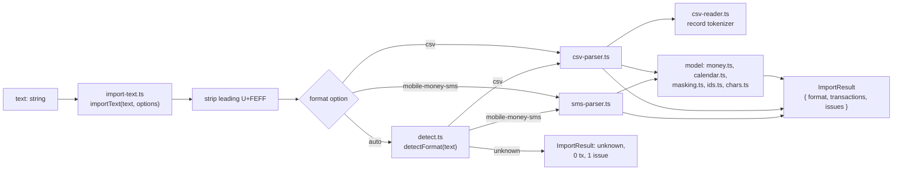

# Design Document

## Overview

Module 1 turns pasted text into typed, validated transaction data. It adds a small pure-TypeScript
model (Money, calendar dates/times, number masking, deterministic ids), two text parsers (CSV and
Mobile-money SMS), a format detector, one entry point (`importText`), two fictional sample texts,
and the lint/test machinery that keeps `src/core` provably pure.

Everything in this module lives in `src/core` and `src/samples`, with no UI and no network. The
binding rules are `.kiro/steering/parsing.md` (money, dates, errors, privacy, identity, naming,
tests); this design does not override any of them. Where `parsing.md` is silent, this design states
a rule that fills the gap without contradicting it.

### Design goals

- Every parser is a pure function: same text and options in, same `ImportResult` out, every time,
  with no exceptions for user-supplied text (`Requirement 16`).
- Money, dates and ids are built with integer/digit arithmetic only — no `parseFloat`, no `Number`
  on decimal text, no `Date`, no `crypto`, no `Math.random` — enforced both by hand and by ESLint
  (`Requirement 18`).
- Any text that cannot be understood becomes an `Issue`, never a thrown exception; only
  programmer errors (bad `Import_Options`, invalid `Money` construction) throw.
- Both sample texts are fully fictional and carry no brand name, matching `product.md` and
  `privacy.md`.

### Out of scope

No analysis, recurring-charge detection, budget logic (Module 2), no UI or React code (Module 3+),
no persistence, no format beyond CSV and Mobile-money SMS, and no currency conversion
(`Requirement 23`).

## Architecture

### Data flow



`src/core` is pure TypeScript: nothing under `src/core` imports React, touches the DOM, performs
network I/O, reads the clock, or generates randomness. `src/samples` imports only from the
`src/core` barrel (`src/core/index.ts`); it never reaches into `src/core` internals. `src/core`
never imports from `src/samples` or `src/ui` — the dependency arrow in the diagram runs only
`samples → core` and `ui → core` (the latter for a later module), never the reverse. This matches
and extends the Module 0 rule that `src/core` has no outgoing edge to `src/ui`.

## Components and Interfaces

### File layout

One line of purpose per file. Every source file's tests sit next to it. The naming rule
(`Requirement 19.5`) is: **one `*.test.ts` per source file**, containing both the example tests and
the fast-check property test(s) for that file, except for the model files `money.ts`, `calendar.ts`
and `masking.ts`, whose property tests are numerous enough (round trip, algebraic laws,
idempotence, never-throws) that they are split as `<name>.test.ts` (examples) plus
`<name>.property.test.ts` (fast-check properties) for readability — the same split Module 0 already
uses for `contrast.ts`/`theme.ts`. This is a documentation choice, not a second rule: every source
file still has exactly one example file and at most one property file, both named after it.
`chars.ts` lives in `src/core/model` because Requirement 19.7 allows new files only in
`src/core/model` and `src/core/parsers` (Decisions D3).

```
src/core/
  model/
    .gitkeep                       kept per Requirement 19.6
    types.ts                       shared types: Money, Transaction, ImportResult, Issue, Import_Options
    types.test.ts                  example tests: type-shape/compile-time usage smoke checks
    issues.ts                      the ISSUES constant: every exact Issue message string (Req 7.9)
    issues.test.ts                 example tests: ISSUES has exactly the 15 documented strings
    money.ts                       Money construction, add, Amount_Grammar parse, format
    money.test.ts                  example tests for money.ts
    money.property.test.ts         property tests for money.ts (round trip, algebra, grammar, limit)
    calendar.ts                    Iso_Date / Time_Of_Day validation, Slash_Date, 12h->24h conversion
    calendar.test.ts                example tests for calendar.ts
    calendar.property.test.ts       property tests for calendar.ts (reference table, never-throws)
    masking.ts                     Digit_Group masking, Mask_Token, excerpt cutting
    masking.test.ts                example tests for masking.ts
    masking.property.test.ts        property tests for masking.ts (idempotence, no long group, excerpt order)
    ids.ts                         FNV-1a Base_Hash, Hash_Input encoding, occurrence counter
    ids.test.ts                    example + property tests for ids.ts (determinism, uniqueness, known vector)
    chars.ts                       ASCII character-code helpers shared by masking, SMS and CSV code (module-internal, not in the Barrel; Decisions D3)
    chars.test.ts                  example tests for chars.ts
  parsers/
    .gitkeep                       kept per Requirement 19.6
    csv-reader.ts                  low-level CSV record tokenizer (quotes, CRLF/LF, delimiter choice, rawText per Record)
    csv-reader.test.ts             example + property tests for the tokenizer (quirks, malformed input)
    csv-parser.ts                  header/column recognition, row-to-Transaction conversion
    csv-parser.test.ts             example + property tests for csv-parser.ts (round trip, columns, rows)
    sms-parser.ts                  message segmentation, six kinds, optional sentences, cost transactions
    sms-parser.test.ts             example + property tests for sms-parser.ts (round trip, six kinds, costs)
    detect.ts                      detectFormat: csv header check, then Message_Start check, else unknown
    detect.test.ts                 example + property tests for detect.ts (order, never-throws)
    import-text.ts                 importText: options defaults/validation, BOM strip, routing, empty-input case
    import-text.test.ts            example + property tests for import-text.ts (never-throws, determinism, totals)
  index.ts                         the Barrel: re-exports the public API, no Test_Only_Helper
src/samples/
  .gitkeep                         kept per Requirement 19.6, 17.9
  csv-sample.ts                    fictional CSV sample text (CSV_SAMPLE constant)
  sms-sample.ts                    fictional Mobile-money SMS sample text (SMS_SAMPLE constant)
  samples.test.ts                  example tests: each sample imports to format/count/currency/range
```

Test-only helpers (generators, the CSV writer, the SMS writer, reference tables such as the
month-length/leap table) live in files named `*.testkit.ts`, colocated with the file(s) whose tests
use them:

```
src/core/
  model/
    money.testkit.ts                Amount_Grammar generators (valid/invalid texts), Money generator
    calendar.testkit.ts             month-length/leap reference table, date/time generators
    masking.testkit.ts              digit-group text generators (space/hyphen separated)
    ids.testkit.ts                  reference FNV-1a implementation, Hash_Input generator
  parsers/
    csv-reader.testkit.ts           the Test_Only_Helper CSV writer, malformed-record generators
    sms-parser.testkit.ts           the Test_Only_Helper SMS writer, the six-kind message generator
```

A `*.testkit.ts` file is imported only by `*.test.ts` and `*.property.test.ts` files and is never
exported by `src/core/index.ts` (`Requirement 21.2`).

Additions to existing files: `tests/eslint-purity.test.ts` gains the six per-name cases, the
test-file-path case, the `Math.imul`/`Number.isSafeInteger` negative control and the
thirteen-name effective-config case (`Requirement 18.7`-`18.11`, detailed in Testing Strategy).
`README.md` gains the "Project structure" lines for every file above, an updated "Money
convention" section, an updated "What it is" status sentence, new documented limits, and an
updated "Built with Kiro" section (`Requirement 21`). `tests/repo-conformance.test.ts` is not
modified by this design — see **Open issues** (point vi).

ESLint and `tsconfig.app.json` coverage check: `eslint.config.js` block 6 is scoped to
`files: ['src/core/**/*.{ts,tsx}']`, which (being a `**` glob) already matches every `*.test.ts`,
`*.property.test.ts` and `*.testkit.ts` file under `src/core`, so the new purity rules
(`Requirement 18.6`) apply to them without a config change. `tsconfig.app.json`'s `include` list
already contains `"src"`, which recursively includes every `.ts` file under `src/core` and
`src/samples`, including `*.testkit.ts` files — no `tsconfig.app.json` change is needed.

### Interfaces

Named exports only, no enums, no namespaces, no parameter properties, no `any`. Signatures only —
no bodies.

**`src/core/model/types.ts`**

```ts
export type Currency = string; // exactly three uppercase letters A-Z, enforced at construction

export interface Money {
  readonly minor: number;
  readonly currency: Currency;
}

export type Source = 'csv' | 'mobile-money-sms';

export interface Transaction {
  readonly id: string;
  readonly occurredOn: string; // Iso_Date "YYYY-MM-DD"
  readonly time?: string; // Time_Of_Day "HH:MM"
  readonly amount: Money;
  readonly description: string;
  readonly counterparty?: string;
  readonly source: Source;
  readonly reference?: string;
}

export interface Issue {
  readonly line: number;
  readonly message: string;
  readonly excerpt: string;
}

export type FormatId = 'csv' | 'mobile-money-sms' | 'unknown';

export interface ImportResult {
  readonly format: FormatId;
  readonly transactions: readonly Transaction[];
  readonly issues: readonly Issue[];
}

export type DateOrder = 'dmy' | 'mdy';

export interface ImportOptions {
  readonly format?: 'auto' | 'csv' | 'mobile-money-sms';
  readonly defaultCurrency?: Currency;
  readonly dateOrder?: DateOrder;
}

export type AmountFailureReason = 'invalid' | 'too-large';

export type ParseOutcome<T> =
  | { readonly ok: true; readonly value: T }
  | { readonly ok: false; readonly reason: AmountFailureReason };
```

Note: `ParseOutcome` is generic and shared by amount, date and time parsing. Date and time parsing
never produce the `too-large` reason; their failures always carry `reason: 'invalid'`. This keeps
one `Parse_Outcome` shape across the module instead of three near-identical ones, satisfying the
glossary's "either a success carrying the value or a failure" definition for all three parsers.

**`src/core/model/issues.ts`**

```ts
export const ISSUES: {
  readonly emptyInput: string;
  readonly unrecognisedText: string;
  readonly unrecognisedHeader: string;
  readonly malformedQuotedField: string;
  readonly unterminatedQuote: string;
  readonly wrongNumberOfFields: (expected: number, found: number) => string;
  readonly invalidDate: string;
  readonly invalidAmount: string;
  readonly amountTooLarge: string;
  readonly currencyMismatch: string;
  readonly invalidDebitOrCredit: string;
  readonly missingDescription: string;
  readonly unexpectedTextBeforeFirstMessage: string;
  readonly unrecognisedMessage: string;
  readonly invalidTransactionCost: string;
};
```

`wrongNumberOfFields` is a function because its text is parameterised ("expected N, found M"); the
other fourteen entries are the literal strings. This one object is the single source of truth for
every Issue message in Requirement 7.9, so no parser hand-writes a message string.

**`src/core/model/money.ts`**

```ts
export function createMoney(minor: number, currency: string): Money;
export function addMoney(a: Money, b: Money): Money;
export function formatMoney(money: Money): string;
export function parseAmountText(
  text: string,
  defaultCurrency: string,
): ParseOutcome<Money>;
export function currencyExponent(currency: string): 0 | 2;
export const AMOUNT_LIMIT: number; // 100_000_000_000
```

**`src/core/model/calendar.ts`**

```ts
export function isLeapYear(year: number): boolean;
export function parseIsoDate(text: string): ParseOutcome<string>;
export function parseSlashDate(text: string, dateOrder: DateOrder): ParseOutcome<string>;
export function parseDate(text: string, dateOrder: DateOrder): ParseOutcome<string>;
export function parseTime24(text: string): ParseOutcome<string>;
export function parseTime12(text: string): ParseOutcome<string>;
export function parseTime(text: string): ParseOutcome<string>;
export function isValidCalendarDate(year: number, month: number, day: number): boolean;
```

**`src/core/model/masking.ts`**

```ts
export const MASK_TOKEN: string; // "[number]"
export function maskText(text: string): string;
export function buildExcerpt(sourceText: string): string; // mask, then cut to 60 chars
```

**`src/core/model/ids.ts`**

```ts
export function fnv1a32Hex(input: string): string; // 8 lowercase hex chars
export function buildHashInput(
  formatId: FormatId,
  isoDate: string,
  minorText: string,
  currency: string,
  maskedDescription: string,
): string;
export function assignTransactionIds<T extends { readonly id: string }>(
  rows: readonly (Omit<T, 'id'> & { readonly hashInput: string })[],
): readonly T[];
```

**`src/core/parsers/csv-reader.ts`**

```ts
export interface CsvRecord {
  readonly fields: readonly string[];
  readonly startLine: number;
  readonly rawText: string; // input slice of the Record, line breaks as one space (Algorithm E)
}

export interface CsvReadOutcome {
  readonly headerLine: CsvRecord | null;
  readonly delimiter: ',' | ';' | '\t';
  readonly records: readonly CsvRecord[];
  readonly issues: readonly Issue[];
}

export function chooseDelimiter(headerLineText: string): ',' | ';' | '\t';
export function readCsv(text: string): CsvReadOutcome;
```

**`src/core/parsers/csv-parser.ts`**

```ts
export function parseCsv(
  text: string,
  defaultCurrency: string,
  dateOrder: DateOrder,
): { readonly transactions: readonly Transaction[]; readonly issues: readonly Issue[] };
export function hasRecognisedCsvHeader(text: string): boolean;
```

**`src/core/parsers/sms-parser.ts`**

```ts
export function parseSms(
  text: string,
): { readonly transactions: readonly Transaction[]; readonly issues: readonly Issue[] };
export function hasMessageStart(text: string): boolean;
```

**`src/core/parsers/detect.ts`**

```ts
export function detectFormat(text: string): FormatId;
```

**`src/core/parsers/import-text.ts`**

```ts
export function importText(text: string, options?: ImportOptions): ImportResult;
```

**`src/core/index.ts`** (Barrel)

```ts
export type {
  Money,
  Transaction,
  Issue,
  ImportResult,
  ImportOptions,
  FormatId,
  Source,
  DateOrder,
  Currency,
  AmountFailureReason,
  ParseOutcome,
} from './model/types.ts';
export { ISSUES } from './model/issues.ts';
export { createMoney, addMoney, formatMoney, parseAmountText, currencyExponent, AMOUNT_LIMIT } from './model/money.ts';
export { isLeapYear, parseDate, parseTime, isValidCalendarDate } from './model/calendar.ts';
export { MASK_TOKEN, maskText, buildExcerpt } from './model/masking.ts';
export { fnv1a32Hex } from './model/ids.ts';
export { importText } from './parsers/import-text.ts';
export { detectFormat } from './parsers/detect.ts';
```

`parseSlashDate`, `parseIsoDate`, `parseTime24`, `parseTime12`, `buildHashInput`,
`assignTransactionIds`, `chooseDelimiter`, `readCsv`, `parseCsv`, `hasRecognisedCsvHeader`,
`parseSms` and `hasMessageStart` are internal helpers used by other `src/core` files and are not
re-exported by the Barrel, satisfying "named exports only" at the module boundary while keeping the
public surface to what `Requirement 21.1` names. The helpers of `src/core/model/chars.ts`
(`isAsciiDigit`, `isAsciiLetter`, `isAsciiUpperOrDigit`, `isWhitespaceCode`, `asciiLowerCode`,
`startsWithKeywordAt`) are module-internal in the same way: exported from `chars.ts` for sibling
files and never exported by the Barrel (Decisions D3).

### Algorithms

This section fixes the exact procedure of every non-trivial function, so that an implementer does
not have to guess. It uses the function and type names of **Interfaces** above. Pseudocode is
written in fenced `text` blocks and is not code. Where this section needs a helper that
**Interfaces** does not list, the helper is named here and marked *internal*. A "module-internal"
helper is exported from its file for use by a sibling `src/core` file and is not re-exported by the
Barrel (the same status as `parseSlashDate` or `readCsv`); a "private" helper is not exported at all.

**Shared conventions.**

- All scanning runs over UTF-16 code units with `charCodeAt` and integer indexes. No algorithm below
  uses a regular expression with a nested quantifier or with overlapping alternatives. Where a flat
  pattern would also work, the algorithm uses a scan, so the time bound does not depend on a regex
  engine.
- *Whitespace* is the set that `String.prototype.trim` removes (U+0009 to U+000D, U+0020, U+00A0,
  U+1680, U+2000 to U+200A, U+2028, U+2029, U+202F, U+205F, U+3000, U+FEFF). Because U+FEFF is in the
  set, a header cell that still carries a byte-order mark trims to its plain name.
- *Digit* is ASCII `0` to `9` only (code 48 to 57). *Letter* is ASCII `A-Z` or `a-z`. Case folding
  for keyword matching is a per-character ASCII helper (`A-Z` maps to `a-z`, every other code
  unchanged). `toLowerCase` and `toUpperCase` are never applied to a whole text, so every index in a
  folded view equals the index in the original.
- **New internal file** `src/core/model/chars.ts` (module-internal, not in the Barrel) holds these
  helpers: `isAsciiDigit(code)`, `isAsciiLetter(code)`, `isAsciiUpperOrDigit(code)`,
  `isWhitespaceCode(code)`, `asciiLowerCode(code)` and
  `startsWithKeywordAt(text, index, keywordLowercase)`. Its example test is `chars.test.ts`. The
  file is listed in File layout, the README list and Traceability (Decisions D3).
- Complexity is stated per algorithm. "Linear" means O(n) in the length of the input text with O(1)
  extra state, except where output size is stated. Every parse function returns a `ParseOutcome` or
  an `Issue`. The only throws are the programmer errors listed in **Error Handling**.

#### A. Amount_Grammar (`parseAmountText`)

**Input and output.** `parseAmountText(text, defaultCurrency)` returns `{ ok: true, value: Money }`
or `{ ok: false, reason }` with reason `"invalid"` or `"too-large"`. It scans once, left to right,
and never uses `BigInt`, `parseFloat`, `Number.parseFloat` or `Number(...)` on decimal text. The
only arithmetic on the text is `value = value * 10 + (code - 48)` on integers.
**Complexity:** linear time, O(1) extra space. **Failure behaviour:** every text failure returns
`ok: false`. The function throws only when `defaultCurrency` is not three uppercase letters, which
`createMoney` reports as a programmer error. `importText` validates the option first, so user text
can never cause that throw.

**Scan order.** After trimming, the text must match this sequence; each step consumes characters or
returns `"invalid"` at once. A syntax failure returns `"invalid"` immediately, whatever the value so
far.

1. Trim. An empty text is `"invalid"`.
2. Optional `(`. If present, the text must end with the matching `)` (step 9).
3. Optional sign marker `-` or `+` (call it the *leading sign*). If a `(` was consumed, a leading
   sign is `"invalid"` (Req 2.7).
4. Optional currency: either a run of letters that must have length exactly 3 (a run of another
   length is `"invalid"`), or one symbol of `$`, `€`, `£`, `¥`. A code is converted to uppercase and
   replaces the default currency. A symbol is consumed and ignored. A code and a symbol together are
   `"invalid"`: after one of them the next character must be whitespace or a digit or a sign, so a
   second one fails the digit step (Req 2.4). A code or symbol after the digits is `"invalid"`
   (`"$5 USD"`).
5. If a currency was consumed: skip whitespace (Req 2.9), then an optional sign marker (the *middle
   sign*), allowed only when there was no leading sign and no `(`. Without a currency, whitespace
   after `(` or after a sign is `"invalid"`: whitespace is allowed only around the whole text and
   between a currency and the digits. A sign followed by whitespace is `"invalid"` (`"USD - 5"`).
6. **Resolve the currency and its exponent now**: `currency = code ?? defaultCurrency`,
   `exp = currencyExponent(currency)`. The decimal rules in step 8 depend on `exp`, so this must
   happen before any decimal digit is read.
7. Integer part. The first character must be a digit. Read the maximal digit run and call its length
   `L1`. If the next character is `,` the text uses thousands grouping: `L1` must be 1 to 3, and every
   `,` must be followed by exactly 3 digits whose next character is not a digit. Any other comma use
   is `"invalid"`, which covers a decimal comma such as `"12,5"` and `"1.234,56"` (Req 2.10, 2.15). A
   run without commas may have any length. Leading zeros are accepted.
8. Optional decimal part: a `.`. If `exp == 0`, a `.` is `"invalid"` (Req 2.12). Otherwise read 1 to
   `exp` digits (call the count `f`). Zero digits (`"5."`) or more than `exp` digits is `"invalid"`
   and nothing is rounded (Req 2.13, 2.14). A text that starts with `.` fails step 7 (`".50"`).
9. If a `(` was consumed, the next character must be `)`; consume it. Then the scan position must be
   at the end of the trimmed text, otherwise `"invalid"`.

**Accumulation and the limit.** Digits of steps 7 and 8 are fed to one accumulator, commas and the
point skipped, so `"1,250.00"` feeds 1, 2, 5, 0, 0, 0. Let `L = AMOUNT_LIMIT = 100_000_000_000`.

```text
grow(d):                       # d is a digit value 0..9
  if over: return              # frozen: arithmetic stops, scanning goes on
  value = value * 10 + d
  if value > L: over = true    # value stays at most L*10 + 9 here

after step 9, with f decimal digits read:
  repeat (exp - f) times: grow(0)        # scale to minor units, one x10 per missing digit
  if over: result "too-large"            # reached only when every syntax rule passed
  negative = parenthesised or leading sign "-" or middle sign "-"
  minor = negative ? 0 - value : value   # 0 - 0 is +0: negative zero cannot occur
  return ok createMoney(minor, currency)
```

**Why no intermediate value reaches 2^53.** Before each `grow`, `value <= L = 1e11`, because a value
above `L` sets `over` and freezes the accumulator. One step produces at most `1e11 * 10 + 9`, about
`1.0e12`, which is far below 2^53 (about `9.007e15`). So every intermediate is an exact integer, and
`over` is the only state that remembers a larger value.

**Why "invalid" and "too-large" stay correct.** `over` freezes arithmetic only. The scan continues
for syntax. Any syntax failure afterwards still returns `"invalid"`, so a 20-digit text with a
decimal comma is `"invalid"`. Only a text that passes every syntax rule and has `over` set returns
`"too-large"`. A value that is above `L` at any step is above `L` after scaling, because scaling only
multiplies by 1 or more, so no valid-below-limit text is wrongly reported (Req 2.16, 2.20, 2.21). The
exact limit `100000000000` never sets `over`, because the test is `value > L`.

**Sign rules (Req 2.5 to 2.8).** Exactly one sign marker is allowed: one `-` or `+` at the start,
or one `-` or `+` between a currency and the digits, or one pair of surrounding parentheses.
Parentheses together with a sign are `"invalid"`. Two signs are `"invalid"`: the second sign
character is not a digit, so step 7 fails. A leading `+` gives a positive amount.

**Worked examples (13).** The table has 13 rows, and each row is one example test in
`money.test.ts` (Decisions D9).

| Input | Default currency | Result |
|---|---|---|
| `1,250.00` | USD | ok, `125000` USD |
| `(500)` | USD | ok, `-50000` USD |
| `-0.00` | USD | ok, `0` (positive zero) USD |
| `.50` | USD | `"invalid"` (step 7: no integer digit) |
| `5.` | USD | `"invalid"` (step 8: no decimal digit) |
| `1.234,56` | USD | `"invalid"` (step 8: three decimal digits, exponent is 2) |
| `+5` | USD | ok, `500` USD |
| `USD -5` | KES | ok, `-500` USD (the code replaces the default currency) |
| `$5 USD` | USD | `"invalid"` (step 9: text left after the digits) |
| `JPY 1500.00` | USD | `"invalid"` (JPY has exponent 0, so a point is not allowed) |
| `1,000,000,000.00` | USD | ok, `100000000000` USD (exactly the limit) |
| `1,000,000,000.01` | USD | `"too-large"` (limit plus 1 minor unit) |
| 200 times `9`, then `x` | USD | `"invalid"` (the limit is passed early, but the syntax failure wins) |

#### B. Calendar and time (`parseDate`, `parseTime`, `parseDateCell`)

**Month lengths and leap years.**

```text
DAYS = [31, 28, 31, 30, 31, 30, 31, 31, 30, 31, 30, 31]      # index = month - 1
isLeapYear(y)            = (y % 4 == 0 and y % 100 != 0) or (y % 400 == 0)
daysInMonth(y, m)        = (m == 2 and isLeapYear(y)) ? 29 : DAYS[m - 1]      # private
isValidCalendarDate(y, m, d) = 1 <= y <= 9999 and 1 <= m <= 12 and 1 <= d <= daysInMonth(y, m)
```

The arguments are integers built from digits. No `Date` object is used. 1900 and 2100 are not leap
years, 2000 and 2024 are.

**`parseDate(text, dateOrder)`.** It does not trim; callers pass an isolated token. Routing:
if `text.length == 10` and `text[4] == "-"`, call `parseIsoDate`; otherwise call `parseSlashDate`.
Anything else, including a month name, another separator or another digit layout, is
`{ ok: false, reason: "invalid" }` (Req 4.9).

- `parseIsoDate`: the layout is exactly `dddd-dd-dd`, checked by index (positions 4 and 7 are `-`,
  the other eight are digits). Year, month and day are built with `n = n * 10 + digit`. Success needs
  `isValidCalendarDate`; the year `0000` fails because `1 <= y`. Output is the same text, re-built
  with zero padding. ISO dates are accepted under both date orders (Req 4.3).
- `parseSlashDate(text, dateOrder)`: find the first `/` at `p1` and the second at `p2`. A missing
  second `/` or a third `/` is `"invalid"`. The part lengths are `a = p1`, `b = p2 - p1 - 1`,
  `c = n - p2 - 1`. The accepted layouts are `a` in 1..2, `b` in 1..2 and `c` in {2, 4}, all digits
  (eight layouts). Then: for `"dmy"`, `day = first` and `month = second`; for `"mdy"`, `month = first`
  and `day = second`. A 2-digit year `yy` becomes `2000 + yy`. A 4-digit year is used as written and
  `0000` fails. The result must pass `isValidCalendarDate`.

**`parseTime24(text)`**: exactly `H:MM` or `HH:MM`: 1 or 2 digits, `:`, exactly 2 digits. Hour is 0 to
23, minute 0 to 59. Output is `pad2(hour) + ":" + pad2(minute)`, where `pad2(n)` is
`n < 10 ? "0" + String(n) : String(n)` (private).

**`parseTime12(text)`**: the same `H:MM` shape with hour 1 to 12, then an optional single space, then
`AM` or `PM` in any letter case (per-character fold), then the end of the text. Two spaces fail. The
hour is converted by this table, then padded:

| 12-hour input | 24-hour hour |
|---|---|
| 12 AM | 00 |
| 1 AM to 11 AM | unchanged |
| 12 PM | 12 |
| 1 PM to 11 PM | hour + 12 |

**`parseTime(text)`**: if the last two characters, folded, are `am` or `pm`, call `parseTime12`,
otherwise `parseTime24`. A time with seconds fails here. Seconds are handled only by the CSV cell
split below.

**CSV date cell (`parseDateCell`, private in `csv-parser.ts`).** It returns the date and an optional
time, or a failure that the caller maps to the Issue `"Invalid date"` (Req 11.2 to 11.4).

```text
parseDateCell(cell, dateOrder):
  s = trim(cell)
  k = index of the first " " or "T" in s, or length(s) if there is none      # "T" is upper case only
  date = parseDate(s[0..k), dateOrder);  if failed: return failure
  if k == length(s): return date only
  rest = s[k+1..]                    # exactly one separator character is consumed
  read hour: 1-2 digits, ":", minute: exactly 2 digits                       # else failure
  if next is ":": read exactly 2 digit seconds, require 00..59, discard them # else failure
  if next is " " followed by A/P: marker = that letter pair (any case), consume " " and marker
  else if next is A/P directly: marker = that letter pair
  if anything is left: return failure              # "Z", "+03:00", a second space, trailing text
  time = marker ? parseTime12(h ":" mm " " marker) : parseTime24(h ":" mm)
  return date and time
```

The seconds are discarded; they must be 00 to 59 (Decisions D5(e)). A time with a marker and an hour above 12 fails in `parseTime12`. A
trailing time zone, `Z` or any other text makes the date bad (Req 11.3).
**Complexity:** linear (every function reads a bounded prefix or the cell once). **Failure
behaviour:** a `ParseOutcome` with reason `"invalid"`, never a throw.

#### C. Digit_Group masking (`maskText`, `buildExcerpt`)

**Definition used by the scan.** A group begins at a digit. After a maximal digit run ending at index
`e`, the group continues only when `text[e]` is exactly one space or exactly one hyphen **and**
`text[e + 1]` is a digit. Then the next run is appended and the test repeats. Two spaces, a dot, a
slash, or a separator that is not followed by a digit end the group. A group therefore starts and
ends with a digit, and its length is its digit count.

```text
maskText(text):
  out = []                       # list of string pieces, joined once at the end
  i = 0
  while i < n:
    if text[i] is not a digit: append the maximal run of non-digits starting at i; advance; continue
    start = i; digits = 0; j = i
    loop:
      while j < n and text[j] is a digit: j++, digits++          # j is one past the last digit
      if j + 1 < n and (text[j] == " " or text[j] == "-") and text[j + 1] is a digit:
        j = j + 1                                                # skip the single separator
        continue loop
      break
    append(digits >= 7 ? MASK_TOKEN : text[start..j))            # separators inside are replaced too
    i = j
  return join(out)
```

**Why the result is idempotent.** `MASK_TOKEN` (`[number]`) contains no digit. Every group that is
left has at most 6 digits and is maximal, and a masked group is never adjacent to a joinable digit
run (such a run would have been part of the same group). So masking the output finds no group of 7
or more digits and changes nothing (Req 5.3, 5.4).
**Complexity:** linear (each character is read once, output pieces are joined once).
**Failure behaviour:** none. Every string is valid input, and the function never throws.

**Worked examples.**

| Input | Output | Reason |
|---|---|---|
| `Call 0700123456 now` | `Call [number] now` | one run of 10 digits |
| `123-4567-8` | `[number]` | hyphens join 3 + 4 + 1 = 8 digits |
| `12 34 56 7` | `[number]` | single spaces join 2 + 2 + 2 + 1 = 7 digits |
| `1234567 8` | `[number]` | 7 + 1 = 8 digits, the space is inside the group |
| `2026-11-05` | `[number]` | 4 + 2 + 2 = 8 digits (accepted known limit, Req 5.2) |
| `123456  7` | `123456  7` | two spaces do not join: groups of 6 and 1 |
| `1234.5678/9012` | `1234.5678/9012` | dots and slashes do not join: groups of 4, 4 and 4 |
| `1234567-x` | `[number]-x` | the hyphen is not followed by a digit, so it stays outside |

**Excerpt.** `buildExcerpt(sourceText)` masks first, then cuts (Req 5.7):

```text
buildExcerpt(sourceText):
  m = maskText(sourceText)
  if length(m) <= 60: return m
  end = 60
  if charCode(m[59]) is a high surrogate (0xD800..0xDBFF): end = 59   # do not split a pair
  return m[0..end)
```

The limit of 60 counts UTF-16 code units. A cut that would separate a surrogate pair is made one
unit earlier, so an excerpt may hold 59 (Decisions D5(f)). Masking before cutting means a group that crosses position 60 is already one
`[number]` token and is never cut in the middle of its digits. **Complexity:** linear.

#### D. Hashing and ids (`fnv1a32Hex`, `buildHashInput`, `assignTransactionIds`)

**UTF-8 bytes: `TextEncoder` or hand-written.** `eslint.config.js` block 6 restricts the nine
Module 0 names in `src/core` (`fetch`, `XMLHttpRequest`, `WebSocket`, `EventSource`, `window`,
`document`, `localStorage`, `sessionStorage`, `navigator`), and Requirement 18 adds `Date`,
`crypto`, `performance` and `parseFloat`. `TextEncoder` is on neither list, so a call would pass
lint. **Choice: a hand-written encoder** (`utf8Bytes`, private in `ids.ts`). Reasons: the
exact treatment of lone surrogates is then a stated rule and not a runtime detail; the code does not
depend on which global the test environment provides; and the testkit reference implementation (the
independent model for Property 20) can use `TextEncoder`, so the two encoders check each other.

```text
utf8Bytes(text) -> list of byte values 0..255:
  i = 0
  while i < n:
    cp = text.codePointAt(i)
    i = i + (cp > 0xFFFF ? 2 : 1)
    if cp in 0xD800..0xDFFF: cp = 0xFFFD          # a lone surrogate: EF BF BD (Decisions D6)
    if cp < 0x80:     emit cp
    elif cp < 0x800:  emit 0xC0 | (cp >> 6),  0x80 | (cp & 0x3F)
    elif cp < 0x10000: emit 0xE0 | (cp >> 12), 0x80 | ((cp >> 6) & 0x3F), 0x80 | (cp & 0x3F)
    else:             emit 0xF0 | (cp >> 18), 0x80 | ((cp >> 12) & 0x3F),
                           0x80 | ((cp >> 6) & 0x3F), 0x80 | (cp & 0x3F)
```

`codePointAt` combines a valid pair into one code point and returns the bare surrogate for a lone
one, which the check maps to U+FFFD. Test vectors for the encoder: `€` gives `E2 82 AC`, U+1F600
gives `F0 9F 98 80`, a lone U+D800 gives `EF BF BD`.

**FNV-1a 32.**

```text
fnv1a32Hex(input):
  hash = 0x811c9dc5                                   # offset basis 2166136261
  for each byte b of utf8Bytes(input):
    hash = hash XOR b
    hash = Math.imul(hash, 16777619) >>> 0            # keep an unsigned 32-bit value
  for shift in 28, 24, 20, 16, 12, 8, 4, 0:           # 8 lowercase hex digits, leading zeros kept
    emit "0123456789abcdef"[(hash >>> shift) & 15]
```

The hex text is built from nibbles of the unsigned value, so `toString` is never called on a
negative number and no padding helper is needed. The `XOR` result can be a negative int32, which
`Math.imul` accepts, and `>>> 0` restores the unsigned value after every step. Reference vectors for
tests: `fnv1a32Hex("")` is `811c9dc5`, `fnv1a32Hex("a")` is `e40c292c`, `fnv1a32Hex("foobar")` is
`bf9cf968`.

**Hash_Input.** `buildHashInput(source, date, minorText, currency, maskedDescription)` returns
`source + "\u001F" + date + "\u001F" + minorText + "\u001F" + currency + "\u001F" + maskedDescription`.
The caller passes `String(minor)` as `minorText` (digits with a leading `-` when negative, no
point), never `formatMoney(...)`. The time, the counterparty and the reference are not part of it
(Req 6.3).

**Counter.** `assignTransactionIds` walks the rows once in transaction order:

```text
counts = new Map()                                   # base id -> occurrences so far
for each row in order:
  base = "tx-" + fnv1a32Hex(row.hashInput)
  n = (counts.get(base) ?? 0) + 1;  counts.set(base, n)
  id = (n == 1) ? base : base + "-" + String(n)
```

**Why ids stay unique even on a hash collision.** Two different rows with the same 32-bit hash share
one `counts` entry, so the second gets `base-2`. Every base id has the fixed form `tx-` plus 8 hex
digits (11 characters). A suffixed id is longer and ends in `-n`, so it can never equal a base id.
Two suffixed ids are equal only if both base and `n` are equal, and within one base the counter
gives each `n` once. So all ids in one result are distinct (Req 6.7). Same text gives the same ids
(Req 6.8) because nothing depends on anything but the rows and their order.

**Not banned.** Requirement 18 forbids exactly `Math.random`, `Number.parseFloat`, `Date`, `crypto`,
`performance` and `parseFloat`. `Math.imul`, `Number.isSafeInteger`, `String()`, `Map`,
`charCodeAt` and `codePointAt` are allowed, and Requirement 18.10 even requires a negative-control
test for `Math.imul` and `Number.isSafeInteger`.
**Complexity:** linear in the input length for the hash, linear in the number of rows for ids
(`Map` operations are expected O(1)). **Failure behaviour:** none for any string; no throw.

#### E. CSV record tokenizer (`readCsv`, `chooseDelimiter`) and row conversion

**Delimiter.** `readCsv` first finds the Header_Line: the first physical line that is not blank (a
physical line ends at LF; a CR directly before the LF is dropped). `chooseDelimiter(headerLineText)`
walks that physical line, toggles an `inQuotes` flag at every `"` and counts `,`, `;` and tab only
when `inQuotes` is false. It returns the highest count, a tie broken comma, then semicolon, then
tab. If all counts are 0 it returns the comma. When a quoted header cell spans several physical
lines, only the first physical line is counted (Decisions D5(b)).

**Character classes.** `D` the chosen delimiter, `LF`, `CR`, `Q` the double quote, `W` other
whitespace, `X` any other character. A `CR` directly followed by `LF` is the first half of a line
break; any other `CR` is an ordinary character (it behaves as `W` after a closing quote).

**Line counter.** `line` starts at 1 and is incremented on **every** LF: a terminating LF, a blank
line's LF and an LF inside a quoted field. A CRLF counts once, because only its LF counts. A lone CR
never counts. `startLine` of a Record is the value of `line` at its first character.

**States and transitions.** The reader keeps the current field text and the list of fields.

| State | `D` | `LF` or `CR`+`LF` | `Q` | `W`, `X`, lone `CR` |
|---|---|---|---|---|
| FieldStart | end field (empty), stay FieldStart | end field (empty), end Record | Quoted (the quote is not stored) | store, go Unquoted |
| Unquoted | end field, go FieldStart | end field, end Record | store a literal `"` (Req 9.6) | store |
| Quoted | store | store, `line++` | go QuoteInQuoted | store |
| QuoteInQuoted | end field, go FieldStart | end field, end Record | store `"`, go Quoted (the `""` escape) | `W`: go AfterClosingQuote; `X`: flag *Malformed* |
| AfterClosingQuote | end field, go FieldStart | end field, end Record | flag *Malformed* | `W`, lone `CR`: stay; `X`: flag *Malformed* |

*Malformed* means: record the Issue, then consume characters up to and including the next LF
(counting it) without looking at quotes, and discard the Record. The text after that LF starts a new
Record, so later Records still parse (Req 9.7). At the end of the text: in FieldStart after a
delimiter, the last empty field ends; in Unquoted, QuoteInQuoted and AfterClosingQuote the field
and Record end; in FieldStart at the very start of a Record no Record exists. In **Quoted** the
quote is unterminated: the rest of the text is the content of this Record, one Record is flagged
*Unterminated quote*, and reading ends (Req 9.8).

**Blank lines and the header.** After a Record ends, if it has exactly one field, that field was
unquoted and it is empty after trimming, the Record is a blank line and is dropped without an
Issue. A line of only spaces is blank too. The first Record that is not blank is the header; its
`startLine` is the Header_Line line. A flagged header is returned as `headerLine` with `fields` set
to `[]` and no reader Issue (Decisions D5(a)).

**Record text for the excerpt (`rawText`).** `CsvRecord` has the field `rawText: string`
(readonly; Decisions D4). The reader builds it as the slice of the input from the first character of
the Record to its end, without the terminating line break, with each LF and each CRLF replaced by
one space. Every Issue excerpt for a Record, whether created by `csv-reader.ts` or by
`csv-parser.ts`, is `buildExcerpt(rawText)`.

**Header cells.** Each header cell is trimmed and folded to ASCII lower case, then compared for
exact equality with the names of Requirement 10. The first matching column wins for each role.
A header is recognised when it has a date column, a description column, and either an amount column
or both a debit column and a credit column. This logic is the module-internal helper
`recogniseHeader(cells)` in `csv-parser.ts`, used by `parseCsv` and `hasRecognisedCsvHeader`.

**Row conversion order in `parseCsv`.** For each Record the first failing check produces the one
Issue; later checks do not run.

1. Field count differs from the header: `"Wrong number of fields: expected N, found M"`.
2. Date cell through `parseDateCell`: `"Invalid date"`.
3. Amount: with an amount column, `parseAmountText(cell, defaultCurrency)`. With debit and credit
   columns: if both cells are empty after trimming or both are not, or the non-empty cell contains
   `-`, `+`, `(` or `)`, `"Invalid debit or credit"`; otherwise parse that cell, and negate a debit
   (`0 - minor`). A failed parse gives `"Amount too large"` for `"too-large"` and `"Invalid amount"`
   for `"invalid"`.
4. `"Currency mismatch"` when the parsed `currency` differs from `defaultCurrency`. Because step 3
   runs first, a cell that is both rejected by the Amount_Grammar and carries a different currency
   code gives the amount error (Requirements 11.10 before 11.16; Decisions D5(c)).
5. Description empty after trimming: `"Missing description"`.

A passing Record becomes a Transaction with `description = maskText(trimmed cell)`, `source: "csv"`
and no counterparty or reference. The Issues of the reader (flagged Records) and of the parser come
from two lists. `parseCsv` merges them by `line` with a two-pointer merge, so `issues` keeps input
order (Req 8.13). Every Issue of a Record has `excerpt = buildExcerpt(record.rawText)`; the
`"Unrecognised header"` Issue uses the `rawText` of the header Record.

**Worked example (10 physical lines, default currency USD, order dmy).** Line numbers are on the left.

```text
 1  Date,Description,Amount
 2  2026-11-01,"Moonlight Cloud Storage",-9.99
 3  
 4  2026-11-02,"Crypt Cafe
 5  Night Shift",-4.50
 6  2026-11-03,Hollow Hill Grocers,-23.10
 7  2026-11-04,"Raven" Rides,-6.00
 8  2026-11-05,Gloom Gym,-30.00,extra
 9  not-a-date,Spectral Streaming,-12.99
10  2026-11-08,"Unfinished,-5.00
```

| Record | `startLine` | Outcome |
|---|---|---|
| header | 1 | recognised, delimiter comma |
| 2 | 2 | Transaction `-999` |
| (blank) | 3 | skipped, no Issue |
| 4 | 4 | quoted field holds an LF (counter goes 4, 5, 6); Transaction `-450`, description `Crypt Cafe` LF `Night Shift` |
| 6 | 6 | Transaction `-2310` |
| 7 | 7 | text `Rides` after the closing quote: Issue `"Malformed quoted field"`, line 7 |
| 8 | 8 | 4 fields: Issue `"Wrong number of fields: expected 3, found 4"`, line 8 |
| 9 | 9 | Issue `"Invalid date"`, line 9 |
| 10 | 10 | quote never closes: Issue `"Unterminated quote"`, line 10; reading ends |

**Complexity:** linear (one pass; the header line is scanned once more by `chooseDelimiter`).
**Failure behaviour:** every malformed input becomes a flagged Record or an `Issue`; there is no
throw.

#### F. SMS segmentation and message parsing (`parseSms`, `hasMessageStart`)

**Message_Start finder (private `nextMessageStart(text, from)`).** A hand-written scan, no regex.
`hasMessageStart(text)` is `nextMessageStart(text, 0) !== null`.

```text
nextMessageStart(text, from):
  i = from
  while i < n:
    if text[i] is not a letter or digit: i++; continue
    r = i; while r < n and text[r] is a letter or digit: r++        # maximal ASCII letter/digit run
    if r - i == 10 and every char of text[i..r) is A-Z or 0-9:       # a lowercase letter fails here
      w = r; while w < n and text[w] is whitespace: w++
      if w > r and startsWithKeywordAt(text, w, "confirmed."):       # one or more whitespace first
        return { codeOffset: i, bodyOffset: w + 10 }
    i = r
  return null
```

The code must not be preceded by a letter or digit, which the run scan guarantees (`i` is always the
start of a run). An 11th letter or digit makes the run longer than 10, so it fails. Time is
linear: every position belongs to one run, and the whitespace after a run is scanned only for that
run.

**Segmentation and offsets.** Collect every start in order: `s_0 .. s_(k-1)`. Message `j` is the
slice of the **original** text from `s_j.codeOffset` to `s_(j+1).codeOffset` (or the end). The
original `codeOffset` is kept for line numbers: `line = 1 + (number of LF in the original text before
codeOffset)`. Because starts are in order, one running LF counter gives all lines in a single pass.
The byte-order mark was removed upstream, a lone CR does not count, and the text is never
whitespace-normalised before this count. For matching, a working copy of each message is built by
one pass that replaces every whitespace run with one space and drops trailing whitespace. Index 0 to
9 of the copy is the code, index 10 is a space, index 11 to 20 is `Confirmed.`.

**Text before the first start.** If the text before `s_0` (or the whole text, when there is no
start) contains a character that is not whitespace, one Issue `"Unexpected text before first
message"` is created. Its `line` is `1 + LF count` up to the first non-whitespace character; its
excerpt is `buildExcerpt` of that text from the first non-whitespace character on, with whitespace
runs reduced to one space.

**Kind matching on the working copy.** The body must begin with exactly one space at index 21;
otherwise the message is unrecognised. Let `B` be the text from index 22. Keywords are matched with
`startsWithKeywordAt` (per-character fold). Names are sliced from the copy, so they keep their
written case. The kind is chosen by the first token, and the first tokens are disjoint, so there is
no ambiguity:

| First token of `B` | Token sequence | Sign | Name |
|---|---|---|---|
| `You have received ` | AMT `" from "` NAME DM | + | NAME |
| `You bought ` | AMT `" of airtime"` DM (DM must start right after `airtime`) | - | none, description `Airtime` |
| `Reversal of ` | CODE `" completed. "` AMT `" credited to your account"` DM (DM right after) | + | none, description `maskText("Reversal of " + CODE)` |
| `Ksh` or `KES` (any case) | AMT then `" paid to "`, `" sent to "` or `" withdrawn from "`, then NAME DM | - | NAME |

CODE is 10 characters, each `A-Z` or `0-9`. A message that matches no row, or whose structure ends
early (for example no Date_Marker), gives `"Unrecognised message"`.

**Sms_Amount (private `extractSmsAmount(copy, p)`).** At `p`: the prefix `ksh` or `kes` (folded),
then one optional space, then the digits text: a maximal digit run; then while the next characters
are `,` and three digits whose next character is not a digit, take them; then, if `.` is followed
by a digit, take `.` and up to 2 digits. A `.` that is not followed by a digit is not part of the
amount. No digits after the prefix means "no amount" (the message is unrecognised). The digits text
is passed to `parseAmountText(digitsText, "KES")`. `"too-large"` gives `"Amount too large"`,
`"invalid"` gives `"Invalid amount"` (Req 13.16). Extraction takes at most 2 decimal digits, so an
amount with three or more decimals (`Ksh5.123`) leaves text that matches no keyword and the message
gives `"Unrecognised message"` (Decisions D5(d)). The prefix is removed first, so the Amount_Grammar
never reads `Ksh` as a currency code. An outflow kind negates the value with `0 - minor`.

**Date_Marker (private `findDateMarker(copy, from)`).** For each `q >= from` where the folded text
at `q` is `" on "`, try to read a complete marker: 1 or 2 digits, `/`, 1 or 2 digits, `/`, exactly 2
digits and no digit after them, `" at "`, 1 or 2 digits, `:`, exactly 2 digits, one space, `AM` or
`PM` (any case), and no letter or digit after. The first `q` that matches is the Date_Marker, and
the name is `copy[nameStart, q)`. A `" on "` without a complete marker is skipped, so
`"Hill on Hill Cafe"` stays whole. Each attempt reads a bounded number of characters, so the search
is linear. The marker only fixes the digit layout; the value is checked afterwards by
`parseSlashDate(sms date, "dmy")` and `parseTime12(sms time)`, and a failure gives `"Invalid date"`.
So a wrong layout (not a complete Date_Marker, for example a 4-digit year) leaves the message
without a marker and gives `"Unrecognised message"`, while a correct layout with an impossible
value (`31/2/26`, `13:00 PM`) gives `"Invalid date"` (Req 13.13; Decisions D5(g)).
The day is always read first whatever `dateOrder` says (Req 13.12).

**Name cleanup (private `cleanName`).** The order is fixed (Req 13.9):

```text
cleanName(name):
  1. if name ends with ".": remove that one character          # the "." before the Date_Marker
  2. e = length(name); if name[e-1] is a digit:
       walk backwards over a digit run; if the char before it is " " or "-" and the char before
       that is a digit, include both and continue (one separator only)      # the trailing Digit_Group
       g = index of the group's first digit; digits = count of digits in it
       if digits >= 7:
         h = g; if name[h-1] == "+": h = h - 1
         if h >= 1 and name[h-1] == " ":                       # exactly one space before the token
           name = name[0 .. h-1)                                # drop token and that one space
  3. name = trim(name)
```

`"Agent 12 0711000222"` has the trailing group `12 0711000222` (11 digits), a space before it, and
becomes `"Agent"`. A group glued to the name (`"Ada0700123456"`) or a name that is only a number
has no space before the token, so nothing is dropped and `maskText` later turns it into `[number]`.
An empty result gives `"Unrecognised message"` (Req 13.10). `counterparty` and `description` are
`maskText(name)`.

**Check order for one message (the first failure is its one Issue).** Kind and structure
(`"Unrecognised message"`), amount (`"Amount too large"`, `"Invalid amount"`), name empty
(`"Unrecognised message"`), date and time (`"Invalid date"`). Every Issue has `line` of the code
and `excerpt = buildExcerpt(copy)`. A message with an Issue adds no Transaction, and the other
messages still parse.

**Fields set.** `source: "mobile-money-sms"`, `reference` is the message's own code (for a reversal
the code that starts the message), currency KES, `occurredOn` from `parseSlashDate`, `time` from
`parseTime12`.

**Tail sentences.** The text after the Date_Marker is the tail. The balance sentence
(`New [word] balance is <amount>.`) is accepted by being ignored: it is not read or stored, so it
cannot cause an Issue. The cost sentence is found by scanning the tail for the first folded
`"transaction cost,"`. If it is absent, nothing happens. If present: skip one optional space and
call `extractSmsAmount`; a missing amount, a `"too-large"` or an `"invalid"` result gives the Issue
`"Invalid transaction cost"` (line of the code), the parent is kept and no cost Transaction exists.
A zero amount creates nothing. A positive amount creates a cost Transaction placed directly after
its parent: amount `0 - minor` KES, description `Transaction cost`, no counterparty, the same
`reference`, `occurredOn` and `time`.

**Example messages (Req 13.15).** Parsed in one text, in order, they give: message 1 gives
`-125000` (cost 0.00, no cost row); message 2 gives `-50000` and then the cost row `-500`; message 3
gives `300000`; message 4 gives `-10000`; message 5 gives `-200000` and then the cost row `-2900`;
message 6 gives `125000`. The list of minor amounts is `-125000, -50000, -500, 300000, -10000,
-200000, -2900, 125000`.

**Regex check.** The SMS parser uses no regular expression. Every pattern above is a fixed token
sequence with bounded digit counts, or a maximal-run scan, so no pattern has a nested quantifier or
overlapping alternatives. **Complexity:** linear (segmentation, copy building, name cleanup,
keyword scans and the line counter are each one pass or a bounded step per position).
**Failure behaviour:** every failure is an `Issue` listed above; no throw.

#### G. Format_Detector and `importText`

**`detectFormat(text)`.** The checks run in this order, and the first that holds returns at once
(Req 15):

1. Empty or whitespace-only text returns `"unknown"`.
2. `hasRecognisedCsvHeader(text)` returns `"csv"`, whatever else the text holds. This is why a CSV
   with a description such as `ABCDEFGHIJ confirmed.` is still `"csv"` (Req 15.7).
3. `hasMessageStart(text)` returns `"mobile-money-sms"`.
4. Otherwise `"unknown"`.

`hasRecognisedCsvHeader` and `recogniseHeader` live in `csv-parser.ts`, and `hasMessageStart` lives
in `sms-parser.ts`. `detect.ts` imports both. Neither parser file imports `detect.ts` or
`import-text.ts`, and `import-text.ts` imports `detect.ts` and both parsers, so the import graph has
no cycle. `hasRecognisedCsvHeader` calls `readCsv`, takes `headerLine` and applies `recogniseHeader`;
a flagged header (empty `fields`) is not recognised.

**`importText(text, options)`.**

```text
importText(text, options):
  1. opts = resolve defaults: format "auto", defaultCurrency "USD", dateOrder "dmy"
     validate: defaultCurrency is 3 uppercase A-Z, format in {auto, csv, mobile-money-sms},
     dateOrder in {dmy, mdy}; any violation THROWS (programmer error)
     # options are validated before the text is looked at: Decisions D2
  2. if text starts with U+FEFF: remove that one character        # line numbers count from here
  3. if text is empty or whitespace-only:
       return { format: "unknown", transactions: [], issues: [Issue(1, "Empty input", "")] }
  4. fmt = (opts.format == "auto") ? detectFormat(text) : opts.format
  5. if fmt == "csv":               r = parseCsv(text, opts.defaultCurrency, opts.dateOrder)
     if fmt == "mobile-money-sms":  r = parseSms(text)             # currency and date order ignored
     if fmt == "unknown":           return { format: "unknown", transactions: [],
        issues: [Issue(line of first non-blank line, "Unrecognised text", buildExcerpt(that line))] }
  6. return { format: fmt, transactions: r.transactions, issues: r.issues }
```

Forced `"csv"` with a bad header gives `format: "csv"` and the one `"Unrecognised header"` Issue from
`parseCsv` (Req 10.7, 10.8). Forced `"mobile-money-sms"` runs `parseSms` even if the text holds no
start, which then gives the one `"Unexpected text before first message"` Issue. The first non-blank
line for step 5 is found by one scan over physical lines; its text is the line without a trailing
CR. Transactions and issues stay in input order, with no de-duplication (Req 8.13).

**Id pass.** Ids come from one run of `assignTransactionIds` over the rows of one result, in
transaction order. Because the parser signatures in **Interfaces** return `Transaction` (with an
`id`), `parseCsv` and `parseSms` each run that pass as their last step, and `importText` must not
run it again, since a second run would add `-2` suffixes to ids it has already assigned
(Decisions D1). **Complexity:** linear overall (each step above is linear
and runs once). **Failure behaviour:** only step 1 can throw, and only for an invalid option.

## Data Models

### Money

`{ minor: number, currency: string }`, both fields `readonly`, so a `Money` is a plain object and
deep-equality (`toEqual`) works directly in tests without a custom matcher (see Open issues, point
vii). `minor` must be `Number.isSafeInteger(minor)`; `currency` must match `/^[A-Z]{3}$/`.
`createMoney` normalises `-0` to `+0` by returning `minor === 0 ? 0 : minor` (which also turns
`-0` into `0` because `-0 === 0` and the literal `0` is positive). Currency exponent is 0 for
`JPY`, `KRW`, `UGX`, `RWF`; 2 otherwise.

### Transaction / Issue / ImportResult / ImportOptions

As in **Interfaces** above. `Import_Options` defaults: `format: 'auto'`, `defaultCurrency: 'USD'`,
`dateOrder: 'dmy'`.

### Internal: CsvRecord / CsvReadOutcome

Internal to `csv-reader.ts`/`csv-parser.ts`, not exported by the Barrel. `CsvRecord` has three
`readonly` fields: `fields`, `startLine` and `rawText` (Decisions D4). `startLine` is the 1-based
physical line (after BOM removal) on which the record began, which may differ from where it ends
when a quoted field spans several physical lines. `rawText` is the slice of the input from the first
character of the Record to its end, without the terminating line break, with each LF and each CRLF
replaced by one space; every Issue excerpt for the Record is `buildExcerpt(rawText)`.

## Correctness Properties

*A property is a characteristic or behavior that should hold true across all valid executions of a
system — essentially, a formal statement about what the system should do. Properties serve as the
bridge between human-readable specifications and machine-verifiable correctness guarantees.*

**Priority tags (Decisions D8).** Every property heading carries a tag, `[P1]` or `[P2]`, as the first word of the title
(`### Property 12: [P1] Title`; the validator rejects the tag between the number and the colon). `[P1]`
means the property guards behaviour that a user or the demo depends on: money parse and format, the
amount limit, calendar validity, masking, the CSV and SMS round trips, never-throws, determinism,
id uniqueness, totals preserved, and detector order. `[P2]` is everything else: construction and
algebra checks, option validation, quirks, issue-text details and line/excerpt details. The six
example messages and the sample data parsing with zero issues are covered by example tests, not by
a numbered property; they count as P1 behaviour.

The prework above classified almost every behavioral acceptance criterion as property-testable:
Module 1 is built entirely from pure functions (parsers, formatters, hashers) with large input
spaces, which is exactly where property-based testing earns its keep. Criteria about lint rules,
file layout, README prose and test-suite meta-structure are not properties; they are covered in
Testing Strategy by the Purity_Test_File, the Conformance_Test_File and code review instead.

### Property 1: [P2] Money construction rejects unsafe integers

*For any* value that is not a safe integer (`NaN`, `Infinity`, a non-integer number, or a number
outside the safe-integer range), constructing a `Money` with that value as `minor` throws.

**Validates: Requirements 1.2**

### Property 2: [P2] Money construction rejects malformed currency codes

*For any* string that is not exactly three uppercase letters A to Z, constructing a `Money` with
that string as `currency` throws.

**Validates: Requirements 1.3**

### Property 3: [P2] Currency exponent is 2 outside the zero-exponent set

*For any* three-uppercase-letter currency code other than `JPY`, `KRW`, `UGX` and `RWF`,
`currencyExponent` returns 2.

**Validates: Requirements 1.5, 1.6**

### Property 4: [P2] Addition sums same-currency amounts and rejects mixed currencies

*For any* two `Money` values with the same currency whose `minor` sum is a safe integer,
`addMoney` returns a `Money` with that currency and the sum of the two `minor` values; *for any*
two `Money` values with different currencies, `addMoney` throws.

**Validates: Requirements 1.7, 1.8**

### Property 5: [P2] Addition is commutative, associative, with zero as identity, and rejects overflow

*For all* same-currency `Money` triples drawn from a range that keeps every pairwise sum a safe
integer, `addMoney(a, b)` equals `addMoney(b, a)`, `addMoney(addMoney(a, b), c)` equals
`addMoney(a, addMoney(b, c))`, and `addMoney(a, zero)` equals `a`. *For any* pair whose sum is not a
safe integer, `addMoney` throws.

**Validates: Requirements 1.9, 1.10**

### Property 6: [P2] Any safe-integer minor is accepted by the constructor

*For any* safe integer and any well-formed three-letter currency code, `createMoney` does not
throw.

**Validates: Requirements 1.11**

### Property 7: [P1] Amount_Grammar accept/reject table

*For all* amount texts built from the grammar's building blocks (optional surrounding whitespace;
an optional currency code or symbol, not both; an optional single sign marker of minus, plus or
parentheses, never two; digits with or without valid thousands-comma grouping; an optional decimal
part whose digit count is validated against the resolved currency's exponent), `parseAmountText`
accepts exactly the texts the grammar of Requirement 2 marks as valid and produces the signed
minor-unit value the grammar implies; and for every generated mutation that breaks one grammar rule
(two signs, code and symbol together, decimal comma, wrong decimal digit count, a point with no
leading digit, a trailing point, malformed comma grouping, a point for a zero-exponent currency),
`parseAmountText` returns a failure with reason `"invalid"`.

**Validates: Requirements 2.1, 2.2, 2.3, 2.4, 2.5, 2.6, 2.7, 2.8, 2.9, 2.10, 2.11, 2.12, 2.13, 2.14, 2.15, 2.21**

### Property 8: [P1] The Amount_Limit boundary is exact

*For any* grammar-valid amount text whose scaled absolute value is exactly the Amount_Limit,
`parseAmountText` accepts it; *for any* grammar-valid amount text whose scaled absolute value
exceeds the Amount_Limit (including a value that would not be a safe integer), `parseAmountText`
returns a failure with reason `"too-large"` and does not throw.

**Validates: Requirements 2.16, 2.20**

### Property 9: [P2] Signed zero normalises to positive zero

*For any* grammar-valid representation of zero carrying a sign marker (a leading minus, or
parentheses), `parseAmountText` returns a `Money` whose `minor` is `Object.is`-equal to `+0`.

**Validates: Requirements 2.17**

### Property 10: [P1] Amount parsing never throws

*For any* string of arbitrary content, `parseAmountText` returns a `ParseOutcome` and never
throws.

**Validates: Requirements 2.19**

### Property 11: [P1] Money formatting is round-trippable, sign-correct and bare

*For all* `Money` values whose absolute `minor` is at most the Amount_Limit, `formatMoney` produces
a string with no thousands separators, no symbol and no currency code; a leading `"-"` exactly when
the value is negative; exactly `currencyExponent` decimal digits and no decimal point when that
exponent is 0; and parsing that formatted string with the Money's own currency as the
`defaultCurrency` produces a `Money` deeply equal to the original.

**Validates: Requirements 3.1, 3.2, 3.3, 3.4**

### Property 12: [P1] Calendar validity matches the reference table

*For all* generated `(year, month, day)` triples, `isValidCalendarDate` agrees with an independently
written reference month-length table (including the leap-year rule for February), and for the four
known reference years 1900, 2000, 2024 and 2100 the leap-year result matches the documented
(no, yes, yes, no) values.

**Validates: Requirements 4.1, 4.2**

### Property 13: [P1] ISO dates parse regardless of Date_Order, slash dates respect it

*For all* valid `"YYYY-MM-DD"` texts, `parseDate` accepts them identically under `dateOrder: 'dmy'`
and `dateOrder: 'mdy'`. *For all* valid `Slash_Date` texts built from a day and a month that are
not both interpretable the other way without changing the value, swapping `dateOrder` between
`'dmy'` and `'mdy'` swaps which generated number is read as the day and which is read as the month.

**Validates: Requirements 4.3, 4.4, 4.5**

### Property 14: [P1] Slash-date year rules

*For all* `Slash_Date` texts with a 2-digit year, the resulting year is 2000 plus the two-digit
value. *For all* `Slash_Date` texts with a 4-digit year other than `"0000"`, the resulting year is
that value unchanged; the year `"0000"` is rejected.

**Validates: Requirements 4.7, 4.8**

### Property 15: [P2] Malformed date texts are rejected

*For all* generated date texts that use a separator other than `"-"` or `"/"`, embed a month name,
or use a digit layout other than the ones Requirement 4 defines, `parseDate` returns a failure.

**Validates: Requirements 4.9**

### Property 16: [P1] Time parsing and the 12-to-24-hour conversion table

*For all* valid 24-hour texts `"H:MM"`/`"HH:MM"` with hour 0-23 and minute 00-59, `parseTime`
returns the zero-padded `"HH:MM"`. *For all* valid 12-hour texts with hour 1-12, minute 00-59 and
an `AM`/`PM` marker in any letter case, `parseTime` returns the hour converted by the documented
table: 12 AM becomes `"00"`, 12 PM stays `"12"`, 1-11 AM is unchanged, and 1-11 PM is hour+12.

**Validates: Requirements 4.10, 4.11, 4.12, 4.13**

### Property 17: [P1] Date and time parsing never throw

*For any* string of arbitrary content, `parseDate` and `parseTime` each return a `ParseOutcome` and
never throw.

**Validates: Requirements 4.14**

### Property 18: [P1] Masking removes long digit groups and leaves short ones, idempotently

*For all* generated texts built from digit groups of varying length joined by single spaces or
single hyphens, `maskText` replaces every Digit_Group of 7 or more digits (together with its
joining separators) with `"[number]"`, leaves every Digit_Group of 6 or fewer digits unchanged, and
masking the masked text again produces the same text (idempotence). *For all* texts, the masked
result contains no Digit_Group of 7 or more digits.

**Validates: Requirements 5.1, 5.3, 5.4**

### Property 19: [P1] Excerpts are masked before being cut to 60 characters

*For all* generated source texts that place a Digit_Group of 7 or more digits so that character 60
of the unmasked text falls inside that group, `buildExcerpt` returns a string with no partially-cut
digit group — masking is applied to the full text first, and the 60-character cut is applied to
the already-masked result, never the reverse.

**Validates: Requirements 5.7**

### Property 20: [P1] Hash computation matches an independent reference and ignores excluded fields

*For all* generated `Hash_Input` strings, `fnv1a32Hex` returns the same 8 lowercase hex digits as
an independently written reference FNV-1a implementation (model-based testing). *For all* generated
transaction field sets that vary only in `time`, `counterparty` or `reference` while keeping
format, date, `minor`, currency and masked description fixed, the Base_Hash computed from them is
identical.

**Validates: Requirements 6.1, 6.2, 6.3**

### Property 21: [P1] Id assignment is deterministic, ordered and collision-safe

*For all* generated sequences of transaction rows (including sequences with repeated identical
rows), the first occurrence of a Base_Hash within the sequence is assigned that Base_Hash as its
id, the n-th occurrence (n ≥ 2), counted in row order, is assigned the Base_Hash followed by
`"-"` and n, every id in the sequence is distinct, and re-running assignment on the same sequence
produces identical ids.

**Validates: Requirements 6.4, 6.5, 6.6, 6.7, 6.8**

### Property 22: [P2] Issue messages are always drawn from the fixed list

*For all* strings fed to `importText` (in every `format` option value), every `Issue.message` in
the result is exactly one of the fifteen strings in `ISSUES`.

**Validates: Requirements 7.9**

### Property 23: [P2] Forced format skips detection; auto format matches the detector

*For all* texts, calling `importText` with `format: 'csv'` or `format: 'mobile-money-sms'` parses
the text with that parser directly (without consulting `detectFormat`), and calling `importText`
with `format: 'auto'` produces a result whose `format` equals `detectFormat(text)`.

**Validates: Requirements 8.5, 8.6**

### Property 24: [P2] Invalid Import_Options throw

*For any* `defaultCurrency` that is not exactly three uppercase letters A to Z, *for any* `format`
other than `"auto"`, `"csv"` or `"mobile-money-sms"`, and *for any* `dateOrder` other than `"dmy"`
or `"mdy"`, calling `importText` with that option throws.

**Validates: Requirements 8.7, 8.8, 8.9**

### Property 25: [P2] SMS parsing ignores defaultCurrency and dateOrder

*For all* Mobile-money SMS texts, varying `defaultCurrency` and `dateOrder` across their full
option ranges produces identical transactions.

**Validates: Requirements 8.10**

### Property 26: [P2] A leading byte-order mark never changes line numbers or content

*For all* texts, prefixing a single U+FEFF character to the text produces an `ImportResult` with
issue line numbers and content identical to parsing the text without the prefix.

**Validates: Requirements 8.11**

Note: BOM removal is performed once, in `import-text.ts`, before text reaches either parser, so
the CSV reader and the SMS parser both see line numbers that already count from the
post-removal text (Requirement 9.10's "after removal of the byte-order mark" is satisfied by this
single upstream strip, not by a second strip inside `csv-reader.ts`).

### Property 27: [P2] Whitespace-only input yields the single Empty-input issue

*For all* strings composed entirely of whitespace (including the empty string), `importText`
returns `format: 'unknown'`, no transactions, and exactly one issue with `line: 1`,
`message: "Empty input"` and an empty excerpt, for every `format` option value.

**Validates: Requirements 8.12**

### Property 28: [P1] The Importer never throws and always returns a well-formed result

*For any* string and *for any* valid `Import_Options`, `importText` returns an `ImportResult` whose
every `Money` satisfies Property 1-6's constraints, whose every `occurredOn` is an `Iso_Date` and
whose every present `time` is a `Time_Of_Day`, and the call never throws.

**Validates: Requirements 16.1, 16.4, 16.5, 20.7**

### Property 29: [P1] Importing the same text and options twice is deterministic

*For all* strings and *for all* valid `Import_Options`, calling `importText` twice with the same
arguments produces deeply equal `ImportResult` values, including ids.

**Validates: Requirements 16.2, 16.3, 20.8**

### Property 30: [P1] CSV round trip preserves rows, order and totals

*For all* generated sets of well-formed CSV rows (date, description, and either an amount or a
debit/credit pair), writing them with the Test_Only_Helper CSV writer and parsing the result with
`parseCsv` produces transactions deeply equal to the generated rows, in the same order, with no
`Issue`, and the sum of `minor` per currency over the transactions equals the sum of the generated
rows' `minor` values.

**Validates: Requirements 11.1, 11.5, 11.6, 11.7, 11.11, 11.13, 16.6, 20.5, 20.11**

### Property 31: [P1] CSV structural quirks round-trip correctly

*For all* generated CSV texts that mix CRLF and LF line breaks, include a lone CR as ordinary text,
place a `Delimiter` or a line break inside a quoted field, escape an internal quote as `""`, or
interleave blank lines between records, `parseCsv` recovers the same transactions as the
line-break-normalised, blank-line-free equivalent text, and the header line is read as the first
line that is not blank.

**Validates: Requirements 9.1, 9.2, 9.5, 9.9**

### Property 32: [P2] Delimiter selection follows frequency and the comma/semicolon/tab tie order

*For all* generated header lines with a controlled count of commas, semicolons and tabs outside
quotes, `chooseDelimiter` returns the character with the highest count, breaking a tie in the
order comma, then semicolon, then tab.

**Validates: Requirements 9.3**

### Property 33: [P1] Malformed and unterminated quotes are reported precisely

*For all* generated CSV records with non-whitespace text after a closing quote, `parseCsv` creates
exactly one `"Malformed quoted field"` issue for that record and skips it, while parsing every other
record. *For all* generated CSV texts with an unterminated quote inside some record, `parseCsv`
creates exactly one `"Unterminated quote"` issue, consumes the remaining text as that record's
content, and parses no further records.

**Validates: Requirements 9.7, 9.8**

### Property 34: [P2] Issue line number and excerpt follow the documented construction

*For all* generated multi-line or erroring CSV records, the resulting `Issue.line` equals the
record's starting physical line (counted after BOM removal), and `Issue.excerpt` equals
`buildExcerpt(rawText)`, where `rawText` is the record's text with each line break replaced by one
space, so the excerpt is that text masked and then cut to at most 60 characters.

**Validates: Requirements 9.10, 9.11, 9.12, 5.7**

### Property 35: [P2] Field-count mismatches are reported with the exact counts

*For all* generated records whose field count differs from the header's field count, `parseCsv`
creates an issue with message `"Wrong number of fields: expected N, found M"` where N and M are
the exact header and record field counts, and continues parsing subsequent records.

**Validates: Requirements 9.12, 11.14**

### Property 36: [P2] Header column selection follows name matching and precedence rules

*For all* generated header lines built from the Date/Description/Amount/Debit/Credit column name
lists in randomised letter case, whitespace padding, column order, and with decoy columns
(including one literally named `"time"`) interspersed, `parseCsv` selects each column as the first
header cell (after trimming and case-insensitive matching) whose name is in the relevant list, uses
the amount column over a debit/credit pair when both are present, and ignores every unselected
column.

**Validates: Requirements 10.1, 10.2, 10.3, 10.4, 10.5, 10.6, 10.11**

### Property 37: [P2] An unrecognised or header-only CSV header behaves per the forced/auto rules

*For all* generated header lines missing a required column, forcing `format: 'csv'` yields
`format: 'csv'`, no transactions and one `"Unrecognised header"` issue on the header's line; with
`format: 'auto'` and no Message_Start anywhere in the text, the same header yields `format:
'unknown'` and one `"Unrecognised text"` issue, never `"Unrecognised header"`. *For all* generated
valid headers followed by no records, `parseCsv` returns `format: 'csv'`, no transactions and no
issues.

**Validates: Requirements 10.7, 10.8, 10.9, 10.10, 11.15, 15.6**

### Property 38: [P1] Date and amount cells follow the Calendar_Module and Amount_Grammar outcomes

*For all* generated date cells (plain dates, dates with a trailing time, invalid trailing text,
calendar-invalid dates), a CSV row's stored `occurredOn`/`time` or `"Invalid date"` issue matches
what `parseDate`/`parseTime` would independently return for that cell (model-based testing). *For
all* generated amount, debit and credit cells, a row's stored `Money` or `"Invalid amount"`/
`"Amount too large"`/`"Currency mismatch"` issue matches what `parseAmountText` would independently
return for that cell under the row's `defaultCurrency`.

**Validates: Requirements 11.2, 11.3, 11.4, 11.10, 11.16**

### Property 39: [P2] Debit/credit cells follow the exactly-one-filled rule

*For all* generated debit/credit cell pairs, `parseCsv` stores a negative amount when only the
debit cell is non-empty, a positive amount when only the credit cell is non-empty, and an
`"Invalid debit or credit"` issue when both or neither cell is non-empty or when either cell
carries a sign marker.

**Validates: Requirements 11.6, 11.7, 11.8, 11.9**

### Property 40: [P2] Missing descriptions are reported and the row is skipped

*For all* generated description cells that are empty after trimming, `parseCsv` creates a
`"Missing description"` issue and skips the row; for all non-empty-after-trim cells, the row's
`description` is the trimmed, masked text.

**Validates: Requirements 11.11, 11.12**

### Property 41: [P1] SMS message round trip preserves messages across any separator mix

*For all* generated sequences of well-formed Sms_Messages (one from each of the six kinds in
Requirement 13, in any mix), joined with any mix of blank lines, single line breaks, a single
space, or no separator, writing them with the Test_Only_Helper SMS writer and parsing the result
with `parseSms` recovers transactions deeply equal to the generated messages, in the same order,
including their cost transactions, with the sum of signed amounts (including costs) equal to the
sum of `minor` over the resulting transactions.

**Validates: Requirements 12.1, 12.2, 13.1, 13.2, 13.3, 13.4, 13.5, 13.6, 16.7, 20.6, 20.11**

### Property 42: [P2] Text before the first Message_Start is reported precisely

*For all* generated texts that prepend non-whitespace text before the first Message_Start,
`parseSms` creates one `"Unexpected text before first message"` issue whose `line` is the 1-based
line of the first non-whitespace character and whose `excerpt` is that text's masked excerpt.

**Validates: Requirements 12.3**

### Property 43: [P2] Internal whitespace runs do not affect parsed fields

*For all* generated well-formed Sms_Messages, padding the whitespace between tokens (including
inserted line breaks) with extra whitespace of any length produces a message that parses to the
same transaction fields as the single-spaced canonical form.

**Validates: Requirements 12.4**

### Property 44: [P2] Issue line and excerpt for a message follow the documented rule

*For all* generated malformed Sms_Messages placed at known text offsets, the resulting `Issue.line`
equals the 1-based line on which that message's Message_Code starts, and `Issue.excerpt` equals the
masked first 60 characters of the message.

**Validates: Requirements 12.5**

### Property 45: [P2] One unrecognised message does not stop the others

*For all* generated message sequences where exactly one message is deliberately malformed and the
rest are well-formed, `parseSms` creates exactly one `"Unrecognised message"` issue for the
malformed message and still produces correct transactions for every other message.

**Validates: Requirements 12.6, 14.7**

### Property 46: [P2] Keyword matching is case-insensitive; names keep their written case

*For all* generated well-formed Sms_Messages with every keyword's letter case randomised
independently, `parseSms` parses the message identically to the canonical-case version, and the
`Sms_Name` in the result keeps exactly the case it was written in.

**Validates: Requirements 12.7, 12.8**

### Property 47: [P2] A Sms_Name containing " on " without a full Date_Marker is kept whole

*For all* generated names that contain the literal substring `" on "` but no syntactically
complete `Date_Marker` immediately after it, the full name (including `" on "`) is kept as the
`Sms_Name`.

**Validates: Requirements 13.8**

### Property 48: [P2] Name cleanup strips the trailing period, drops the Phone_Token, then trims

*For all* generated names built as `<base><optional "."><optional " " + Phone_Token>`, `parseSms`
strips exactly one trailing `"."` immediately before the Date_Marker, then drops the Phone_Token
together with its one preceding space, then trims the result; *for all* generated names with a
digit group glued to the base with no preceding space, that group remains in the name text (and is
later masked by Property 18).

**Validates: Requirements 13.9**

### Property 49: [P2] An empty name after cleanup is unrecognised

*For all* generated names that reduce to the empty string after the Property 48 cleanup steps,
`parseSms` creates an `"Unrecognised message"` issue for that message.

**Validates: Requirements 13.10**

### Property 50: [P2] Fixed SMS fields are set correctly on every kind

*For all* generated Sms_Messages of any of the six kinds, the resulting transaction has
`source: 'mobile-money-sms'`, `currency: 'KES'`, and `reference` equal to that message's own
leading Message_Code (for a reversal, the code that starts the message, not the code named inside
it).

**Validates: Requirements 13.11**

### Property 51: [P2] Sms_Date/Sms_Time conversion is dateOrder-independent and day-first

*For all* generated valid `Sms_Date`/`Sms_Time` pairs, and *for all* `dateOrder` option values,
`parseSms` produces the identical `occurredOn`/`time`, always reading the Sms_Date day first.

**Validates: Requirements 13.12**

### Property 52: [P2] Impossible Sms_Date or Sms_Time values are Invalid date, wrong layouts are unrecognised

*For all* generated messages whose `Sms_Date`/`Sms_Time` has the correct layout of a complete
`Date_Marker` but an impossible value (for example `31/2/26` or `13:00 PM`), `parseSms` creates an
`"Invalid date"` issue for that message. *For all* generated messages whose date or time has a wrong
layout, so that the text is not a complete `Date_Marker` (for example a 4-digit year), `parseSms`
creates an `"Unrecognised message"` issue instead (Decisions D5(g)).

**Validates: Requirements 13.13, 12.6**

### Property 53: [P1] Sms_Amount extraction matches the Amount_Grammar under KES

*For all* generated `Sms_Amount` texts (varying prefix case, thousands grouping, decimal digits),
removing the `"Ksh"`/`"KES"` prefix and parsing the remaining digits text with `parseAmountText`
under currency `KES` produces the same outcome `parseSms` uses for that amount, including the
`"Amount too large"`/`"Invalid amount"` issue on a grammar failure.

**Validates: Requirements 13.14, 13.16**

### Property 54: [P2] Optional balance and cost sentences do not change the parent transaction

*For all* generated well-formed Sms_Messages, adding, removing, or varying a
`"New [word] balance is <amount>."` sentence after the Date_Marker leaves the resulting parent
transaction's fields unchanged other than the message text consumed.

**Validates: Requirements 14.1, 14.2**

### Property 55: [P1] Transaction cost sentences create a cost transaction exactly when positive

*For all* generated `"Transaction cost, <amount>."` sentences, `parseSms` creates a second
transaction with the negative cost amount, description `"Transaction cost"`, no counterparty, and
the parent's `reference`/`occurredOn`/`time`, placed immediately after the parent in the result,
exactly when the parsed amount is greater than zero; when the amount is exactly zero, no cost
transaction is created.

**Validates: Requirements 14.3, 14.4, 14.5**

### Property 56: [P2] A malformed transaction-cost sentence is reported without losing the parent

*For all* generated messages containing the text `"Transaction cost,"` followed by text that is not
a valid `Sms_Amount` (including one that is grammar-valid but rejected as `"too-large"`),
`parseSms` keeps the parent transaction, creates no cost transaction, and creates one
`"Invalid transaction cost"` issue with `line` set to the message's Message_Code line.

**Validates: Requirements 14.6**

### Property 57: [P1] Format detection follows its three-check order and never throws

*For all* generated texts with a recognised CSV header, `detectFormat` returns `"csv"` regardless
of any trailing text (even text containing a Message_Start). *For all* generated texts without a
recognised header but containing a Message_Start anywhere, `detectFormat` returns
`"mobile-money-sms"`. *For all* generated texts with neither, including whitespace-only texts,
`detectFormat` returns `"unknown"`. *For any* string of arbitrary content, `detectFormat` returns
one of the three values and never throws.

**Validates: Requirements 15.1, 15.2, 15.3, 15.4, 15.5**

### Property 58: [P2] Barrel exports contain the public API and no Test_Only_Helper

*For the* `src/core/index.ts` module, the set of named exports equals exactly the names listed in
`Requirement 21.1`, and contains no identifier whose name or JSDoc marks it as a `Test_Only_Helper`.

**Validates: Requirements 21.1, 21.2**

**Property reflection.** Several criteria that look independent collapse into one property
because one subsumes the other:

- Requirement 11.13 (source/counterparty/reference on CSV rows) and 11.15 (format "csv" on a
  recognised header) are folded into Property 30's round-trip property, which already constructs
  and asserts full transactions.
- Requirement 6.7 (unique ids) and 6.8 (determinism) are both consequences of Property 21's and
  Property 29's stronger statements (occurrence-counted assignment and whole-result determinism),
  so no separate uniqueness-only property is written.
- Requirement 9.4/9.6 (quoted-field delimiter/linebreak acceptance, literal quote in an unquoted
  field) are exercised inside Property 31's round trip rather than as their own property, because
  the CSV writer's quoting logic already has to produce these cases to round-trip arbitrary field
  text.
- Requirement 16.4/16.5 (every Money/date/time is well-formed) is folded into Property 28 rather
  than written as a standalone shape property, because Property 28's generator already ranges over
  arbitrary text and the shape checks are additional assertions on the same run.
- The "accept" half and the "reject" half of the Amount_Grammar (Requirements 2.1-2.15, 2.21) are
  one property (Property 7), not two, because they are two assertions inside a single generator
  that extends a valid amount with one grammar-breaking mutation at a time.

## Error Handling

### Issues (never thrown)

| Message | Created by | Line | Excerpt |
|---|---|---|---|
| `"Empty input"` | `import-text.ts`, when text is empty/whitespace-only | 1 | empty string |
| `"Unrecognised text"` | `import-text.ts`, auto mode, detector returns "unknown" on non-empty text | first non-blank line | masked excerpt of that line |
| `"Unrecognised header"` | `csv-parser.ts`, forced "csv" with a header missing a required column, or a flagged header with no fields | header's line | `buildExcerpt(rawText)` of the header Record |
| `"Malformed quoted field"` | `csv-reader.ts`, text after a closing quote before the next delimiter/line break | record's start line | `buildExcerpt(rawText)` |
| `"Unterminated quote"` | `csv-reader.ts`, a quoted field with no closing quote | record's start line | `buildExcerpt(rawText)` |
| `"Wrong number of fields: expected N, found M"` | `csv-parser.ts`, a record's field count differs from the header's | record's start line | `buildExcerpt(rawText)` |
| `"Invalid date"` | `csv-parser.ts` (bad date cell), `sms-parser.ts` (a complete Date_Marker with an impossible value such as `31/2/26` or `13:00 PM`) | record/message start line | record: `buildExcerpt(rawText)`; message: message excerpt |
| `"Invalid amount"` | `csv-parser.ts`, `sms-parser.ts`; Amount_Grammar failure reason "invalid" | record/message start line | record: `buildExcerpt(rawText)`; message: message excerpt |
| `"Amount too large"` | `csv-parser.ts`, `sms-parser.ts`; Amount_Grammar failure reason "too-large" | record/message start line | record: `buildExcerpt(rawText)`; message: message excerpt |
| `"Currency mismatch"` | `csv-parser.ts`, amount cell accepted by the Amount_Grammar but its currency differs from `defaultCurrency` (an amount error on the same cell wins, Decisions D5(c)) | record's start line | `buildExcerpt(rawText)` |
| `"Invalid debit or credit"` | `csv-parser.ts`, debit/credit cells both filled, both empty, or carrying a sign marker | record's start line | `buildExcerpt(rawText)` |
| `"Missing description"` | `csv-parser.ts`, description cell empty after trimming | record's start line | `buildExcerpt(rawText)` |
| `"Unexpected text before first message"` | `sms-parser.ts`, non-whitespace text before the first Message_Start | line of the first such character | masked excerpt of that text |
| `"Unrecognised message"` | `sms-parser.ts`, a message matches none of the six kinds (this includes a wrong date layout that is not a complete Date_Marker, and an amount with three or more decimals), or its name is empty after cleanup | message's Message_Code line | masked first 60 chars of the message |
| `"Invalid transaction cost"` | `sms-parser.ts`, "Transaction cost," with no valid following amount | message's Message_Code line | masked first 60 chars of the message |

Every excerpt is produced by `buildExcerpt`: mask first, then cut to 60 characters (Property 19).

### Thrown exceptions (programmer errors only)

| Situation | Thrown by |
|---|---|
| `minor` is not a safe integer | `createMoney` |
| `currency` is not exactly three uppercase A-Z letters | `createMoney` |
| Adding two `Money` values with different currencies | `addMoney` |
| The sum of two `Money` values is not a safe integer | `addMoney` |
| `Import_Options.defaultCurrency` is not exactly three uppercase A-Z letters | `importText` |
| `Import_Options.format` is not `"auto"`, `"csv"` or `"mobile-money-sms"` | `importText` |
| `Import_Options.dateOrder` is not `"dmy"` or `"mdy"` | `importText` |

`importText` validates `Import_Options` before touching the text, so an invalid option always
throws regardless of the text's content, even when the text is blank (Decisions D2). `parseAmountText`, `parseDate`, `parseTime` and
`detectFormat` never throw for any string input (Properties 10, 17, 57) — `importText` itself never
throws for any string input when `Import_Options` are valid (Property 28), which is the formal
statement of "importText never throws on any text."

## Testing Strategy

### Generators and Test_Only_Helper writers

- `money.testkit.ts`: a grammar-valid `Amount_Text` generator built compositionally (sign × code-or-symbol
  × digit body × decimal part) so invalid-mutation generators can flip exactly one axis; a `Money`
  generator bounded by `AMOUNT_LIMIT`.
- `calendar.testkit.ts`: the independent month-length/leap-year reference table (plain data, not
  `Date`-derived); generators for valid and deliberately malformed date/time texts.
- `masking.testkit.ts`: a generator for text built from digit runs of controlled length joined by
  single spaces, single hyphens, or other separators (to also generate the non-joining case).
- `ids.testkit.ts`: an independent reference FNV-1a-32 implementation, written separately from
  `ids.ts`'s, for the model-based property; a `Hash_Input` field-set generator.
- `csv-reader.testkit.ts`: the Test_Only_Helper CSV writer (quotes a field exactly when it contains
  the chosen delimiter, a quote, or a line break; doubles internal quotes); generators for
  malformed records (trailing text after a quote, unterminated quotes) and line-break/blank-line
  mixes.
- `sms-parser.testkit.ts`: the Test_Only_Helper SMS writer, one function per kind, composing
  Message_Code + verb phrase + Sms_Amount + Sms_Name + Date_Marker + optional balance/cost
  sentences; a generator for separator mixes between messages.

None of these files use `Math.random`, `Date`, `crypto`, `performance`, `parseFloat`,
`Number.parseFloat`, or `Number()`/`parseFloat()` on a decimal string (`Requirement 20.13`).
**fast-check's own internal randomness is allowed**: fast-check is a declared `devDependency`
(library code, not a banned global), and `Requirement 18` bans specific *globals* (`Math.random`,
`Date`, `crypto`, `performance`, `parseFloat`) and specific *properties*
(`Math.random`, `Number.parseFloat`) — fast-check's generators call neither; they implement their
own seeded PRNG internally, which this module's code never calls directly.

### Property test configuration

Every property test calls `fc.assert(fc.property(...), { numRuns: 100 })` or higher, and carries a
comment in the format `// Feature: 01-parsers, Property {n}: {property text}` directly above the
`it(...)` call, matching each numbered property above one-to-one.

### "Req N.M" naming rule (Requirement 22.2)

Every test (`it(...)` title or an adjacent comment) names every acceptance criterion it covers in
the literal form `"Req N.M"` (for a whole requirement, `"Req N"`). A single test may carry several
tags, e.g. `// Req 2.16, Req 2.20` above a boundary test. Property tests additionally carry the
`Feature: 01-parsers, Property n` tag from the previous section; both tags may appear in the same
comment block.

### Criterion coverage checking (Requirement 22)

Criterion coverage is checked after every spec task by the hook
`.kiro/hooks/requirement-coverage-after-task.json`, and by a read-only script run in the final
verification task (Requirement 22.5). The repository gets no test that reads the requirements file
(Decisions D7). The `"Req N.M"` naming rule above stays as a naming convention that the hook and
the script rely on. Such a check can only see that a tag exists, not that the tagged test exercises
the right behaviour; the final verification task lists the criteria that no automated test can
decide (Requirement 22.5).

### Worked examples as example tests

The 13 worked examples of Algorithm A (the amount parser) are 13 example tests in `money.test.ts`
(Decisions D9). The worked examples of the masking table and the six example messages of
Requirement 13.15 are example tests too.

### Mutation checks

A mutation check will be run later, outside this module's tasks, in three places: the Amount_Grammar
(`money.ts`, `parseAmountText`), the CSV tokenizer (`csv-reader.ts`, `readCsv`) and the SMS parser
(`sms-parser.ts`). The P1 properties of those areas are the ones the mutants must be caught by:
Properties 7, 8, 10 and 11 for the amount parser, Properties 30, 31 and 33 for the CSV tokenizer,
and Properties 41, 53 and 55 for the SMS parser. This design names no tool and adds no dependency.

### Lint test additions (`tests/eslint-purity.test.ts`)

Following the existing per-name, table-driven style:

- Six new `it.each` cases, one per forbidden name (`Math.random`, `Number.parseFloat`, `Date`,
  `crypto`, `performance`, `parseFloat`), each linting a one-line snippet using that name in a
  virtual path under `src/core/x.ts`, asserting the matching rule id (`no-restricted-properties` for
  the first two, `no-restricted-globals` for the other four), severity 2, and that the message
  contains the name token (`Requirement 18.7`, `18.8`).
- One case that lints a forbidden-name snippet in a virtual path `src/core/x.test.ts` (ending in
  `.test.ts`) and asserts an error, proving the rules are not relaxed for test files
  (`Requirement 18.9`, `18.6`).
- One negative-control case that lints `export const a = Math.imul(1, 2); export const b =
  Number.isSafeInteger(3);` in `src/core/x.ts` and asserts zero messages (`Requirement 18.10`),
  confirming these two safe, similarly-named members are not accidentally caught by the new rules.
- One `effective config` case (alongside the existing two) that reads the effective configuration
  for `src/core/x.ts` and asserts `no-restricted-globals` contains all thirteen names (the nine
  from Module 0 plus `Date`, `crypto`, `performance`, `parseFloat`) and `no-restricted-properties`
  contains both `Math.random` and `Number.parseFloat` (`Requirement 18.11`).

### `eslint.config.js` changes

Two edits, both inside the existing flat-config array, preserving every current rule:

1. **New `no-restricted-properties` block**, added once, scoped to `src/core`:

   ```js
   // 6b. Purity: forbid Math.random and Number.parseFloat in src/core (Req 18.1, 18.2).
   {
     files: ['src/core/**/*.{ts,tsx}'],
     rules: {
       'no-restricted-properties': [
         'error',
         {
           object: 'Math',
           property: 'random',
           message: 'src/core must not use randomness — Math.random is forbidden.',
         },
         {
           object: 'Number',
           property: 'parseFloat',
           message: 'src/core must not parse decimal text with Number.parseFloat.',
         },
       ],
     },
   },
   ```

2. **Block 6's `no-restricted-globals` list is restated with four more names**, because flat-config
   blocks matching the same files merge with the later rule value replacing the earlier one
   (the same reasoning Module 0's design already documents for that block):

   ```js
   'no-restricted-globals': [
     'error',
     ...networkGlobals,
     { name: 'window', message: 'src/core must not touch the DOM.' },
     { name: 'document', message: 'src/core must not touch the DOM.' },
     { name: 'localStorage', message: 'src/core must not touch browser storage.' },
     { name: 'sessionStorage', message: 'src/core must not touch browser storage.' },
     { name: 'navigator', message: 'src/core must not touch the DOM.' },
     { name: 'Date', message: 'src/core must not read the clock — Date is forbidden.' },
     { name: 'crypto', message: 'src/core must not use crypto for ids or randomness.' },
     { name: 'performance', message: 'src/core must not read the clock.' },
     { name: 'parseFloat', message: 'src/core must not parse decimal text with parseFloat.' },
   ],
   ```

   This yields thirteen names total: `fetch`, `XMLHttpRequest`, `WebSocket`, `EventSource`,
   `window`, `document`, `localStorage`, `sessionStorage`, `navigator`, `Date`, `crypto`,
   `performance`, `parseFloat` — matching `Requirement 18.4` and `18.11` exactly (verified against
   the live file; see Open issues point iii for the count derivation).

Both blocks are scoped to `files: ['src/core/**/*.{ts,tsx}']`, the same glob as the existing block
6, so block ordering within the array only needs the `no-restricted-properties` block to appear
anywhere after block 1 (no rule merge conflict exists for a rule name block 6 didn't already set).

### Conformance and README changes

- `tests/repo-conformance.test.ts` is **not** modified by this design (see Open issues, point vi).
- `README.md`:
  - "Project structure" gains every line in the **File layout** table above, each with the short
    purpose text already given. The block uses the indentation of the real README block (two spaces
    per level, folder names ending in "/"). The model folder lines, including the helper file, are:

    ```text
        model/
          types.ts                 shared types
          ids.ts                   FNV-1a hash and transaction ids
          ids.test.ts              tests for ids.ts
          chars.ts                 ASCII character-code helpers (module-internal)
          chars.test.ts            example tests for chars.ts
    ```

    The lines for the other model, parser and sample files follow the same form. `chars.ts` and
    `chars.test.ts` are in the list because the Conformance_Test_File checks every listed path and
    Requirement 21.3 asks for every added file (Decisions D3).
  - "Money convention" is rewritten to describe the `Money` type, the `currencyExponent` rule
    (0 for JPY/KRW/UGX/RWF, 2 otherwise), and the "parsed digit by digit, never with `parseFloat`"
    rule, removing the "no money type exists yet" sentence.
  - "What it is" status sentence changes to state that import parsing (Summon) exists and that the
    graveyard and exorcism features do not yet.
  - A new paragraph documents the known limits: the Requirement 5.2 digit-grouping limits, the
    Requirement 13.9 Phone_Token limit, the `AMOUNT_LIMIT` value, the two supported formats and
    their labels, and the `Import_Options` defaults.
  - "Built with Kiro" gains a line naming `.kiro/specs/01-parsers` and `.kiro/steering/parsing.md`,
    and lists both existing hook files (`core-tests-on-save.json`,
    `requirement-coverage-after-task.json`) by name, since both already exist.

## Traceability

`model/chars.ts` and `model/chars.test.ts` serve the requirements whose algorithms scan text with
the ASCII helpers: masking (5), CSV reading and rows (9, 10, 11), SMS parsing (12, 13, 14) and
detection (15). Money (2) and calendar (4) code may use `isAsciiDigit` too, but this design does not
require it, so they are not listed (Decisions D3).

| Requirement | Source files | Test files | Properties (P1/P2) |
|---|---|---|---|
| 1 | `model/money.ts` | `model/money.test.ts`, `model/money.property.test.ts` | 1 (P2), 2 (P2), 3 (P2), 4 (P2), 5 (P2), 6 (P2) |
| 2 | `model/money.ts` | `model/money.property.test.ts`, `model/money.testkit.ts` | 7 (P1), 8 (P1), 9 (P2), 10 (P1) |
| 3 | `model/money.ts` | `model/money.property.test.ts`, `model/money.test.ts` | 11 (P1) |
| 4 | `model/calendar.ts` | `model/calendar.property.test.ts`, `model/calendar.test.ts`, `model/calendar.testkit.ts` | 12 (P1), 13 (P1), 14 (P1), 15 (P2), 16 (P1), 17 (P1) |
| 5 | `model/masking.ts`, `model/chars.ts` | `model/masking.property.test.ts`, `model/masking.test.ts`, `model/masking.testkit.ts`, `model/chars.test.ts` | 18 (P1), 19 (P1), 34 (P2) |
| 6 | `model/ids.ts` | `model/ids.test.ts`, `model/ids.testkit.ts` | 20 (P1), 21 (P1) |
| 7 | `model/types.ts`, `model/issues.ts` | `model/types.test.ts`, `model/issues.test.ts`, `parsers/import-text.test.ts` | 22 (P2) |
| 8 | `parsers/import-text.ts` | `parsers/import-text.test.ts` | 23 (P2), 24 (P2), 25 (P2), 26 (P2), 27 (P2) |
| 9 | `parsers/csv-reader.ts`, `model/chars.ts` | `parsers/csv-reader.test.ts`, `parsers/csv-reader.testkit.ts`, `model/chars.test.ts` | 31 (P1), 32 (P2), 33 (P1), 34 (P2), 35 (P2) |
| 10 | `parsers/csv-parser.ts`, `model/chars.ts` | `parsers/csv-parser.test.ts`, `model/chars.test.ts` | 36 (P2), 37 (P2) |
| 11 | `parsers/csv-parser.ts`, `model/chars.ts` | `parsers/csv-parser.test.ts`, `model/chars.test.ts` | 30 (P1), 35 (P2), 37 (P2), 38 (P1), 39 (P2), 40 (P2) |
| 12 | `parsers/sms-parser.ts`, `model/chars.ts` | `parsers/sms-parser.test.ts`, `parsers/sms-parser.testkit.ts`, `model/chars.test.ts` | 41 (P1), 42 (P2), 43 (P2), 44 (P2), 45 (P2), 46 (P2), 52 (P2) |
| 13 | `parsers/sms-parser.ts`, `model/chars.ts` | `parsers/sms-parser.test.ts`, `model/chars.test.ts` | 41 (P1), 47 (P2), 48 (P2), 49 (P2), 50 (P2), 51 (P2), 52 (P2), 53 (P1) |
| 14 | `parsers/sms-parser.ts`, `model/chars.ts` | `parsers/sms-parser.test.ts`, `model/chars.test.ts` | 45 (P2), 54 (P2), 55 (P1), 56 (P2) |
| 15 | `parsers/detect.ts`, `model/chars.ts` | `parsers/detect.test.ts`, `model/chars.test.ts` | 37 (P2), 57 (P1) |
| 16 | `parsers/import-text.ts` | `parsers/import-text.test.ts` | 28 (P1), 29 (P1), 30 (P1), 41 (P1) |
| 17 | `src/samples/csv-sample.ts`, `src/samples/sms-sample.ts` | `src/samples/samples.test.ts` | none (example tests) |
| 18 | `eslint.config.js` | `tests/eslint-purity.test.ts` | none (lint tests) |
| 19 | (all Module 1 files) | `tests/repo-conformance.test.ts` (existing checks), code review | none |
| 20 | (all property tests) | every `*.property.test.ts` and `*.test.ts` file listed above | 28 (P1), 29 (P1), 30 (P1), 41 (P1) |
| 21 | `src/core/index.ts`, `README.md` | `src/core/index.test.ts` (barrel export check), `tests/repo-conformance.test.ts` | 58 (P2) |
| 22 | no source file | none in the repository; checked by the hook `.kiro/hooks/requirement-coverage-after-task.json` and the final verification script (Requirement 22.5) | none |
| 23 | — (scope) | code review, `tests/repo-conformance.test.ts` (existing folder/file checks) | none |

Note: `src/core/index.test.ts` (Property 58's barrel-export-surface check) is an additional test
file not listed in the File layout table's enumeration above; it is added alongside
`src/core/index.ts` following the same "test next to source" rule.

## Risks

The five trickiest parts of this module, and how the design contains each:

1. **SMS message segmentation and the six-kind grammar.** Segmentation must find every
   Message_Start without being confused by a Message_Code-like word inside another message's name
   or a CSV description (Requirement 15.7). The design fixes the exact Message_Start definition
   (10 uppercase-alnum chars, not preceded by a letter/digit, then whitespace, then
   case-insensitive "Confirmed.") and requires the kind-matching to start exactly at the text after
   "Confirmed." (Requirement 13.7), which keeps the segmenter and the kind-matcher as two separate,
   independently testable stages (Properties 41, 46, 50) instead of one tangled regular expression.
2. **CSV quote handling.** Quoted fields may contain delimiters, line breaks and escaped quotes,
   and must distinguish "malformed" (text after a closing quote) from "unterminated" (no closing
   quote) with different recovery behavior (skip one record vs. stop entirely). The design isolates
   this in one file, `csv-reader.ts`, as an explicit state machine (see Algorithms notes in the
   Components section) with its own round-trip property (Property 31) and dedicated malformed-input
   properties (Property 33), so the tokenizer's correctness does not depend on the column-mapping
   logic in `csv-parser.ts` also being right.
3. **The Amount_Limit boundary and digit-by-digit arithmetic.** Parsing amounts without
   `parseFloat`/`Number` on decimal text, while correctly deciding "too-large" vs. "invalid" and
   handling the exact-boundary case, is easy to get subtly wrong (off-by-one at the limit, wrong
   reason on overflow). The design fixes the precise order (syntax checked fully first via the
   grammar; size checked only after a syntactically valid value is assembled) and gives it two
   dedicated properties (7 for syntax, 8 for the limit boundary) plus a lint-enforced ban on the
   dangerous functions, so a regression is caught by either the properties or the purity tests.
4. **Digit-group masking interacting with the 60-character excerpt cut.** Masking a group that
   straddles the 60th character differently depending on cut-then-mask vs. mask-then-cut order is
   the kind of bug that only shows up at a specific length. The design fixes the order explicitly
   (mask first, cut second) and gives it its own property (Property 19) with a generator designed
   to place a long digit group across that exact boundary, rather than relying on general-purpose
   random text to stumble onto the case.
5. **UTF-8 encoding for the FNV-1a hash, including surrogate pairs.** Hand-written UTF-8 encoding
   (needed because the Hash_Input must be hashed as bytes, and because `TextEncoder` availability
   under the "no DOM" constraint needs confirming) is a classic source of off-by-one and
   lone-surrogate bugs that silently produce wrong-but-plausible hashes instead of crashing. The
   design gives this its own independently-written reference implementation for a model-based
   property (Property 20) rather than testing `ids.ts` against itself, so a shared encoding mistake
   in both implementations is the only way this risk escapes the test suite. The surrogate policy is
   decided: a lone surrogate is encoded as U+FFFD (see Decisions D6 and Algorithm D).

## Decisions

One line per decision. The rest of this document follows each of them.

- **D1.** Ids are assigned inside `parseCsv` and `parseSms` as their last step. `importText` does not run the id pass again. Property 30 stays as it is.
- **D2.** `Import_Options` are validated before the text is looked at. Invalid options throw even when the text is blank.
- **D3.** The helper file `chars.ts` with `chars.test.ts` is kept in `src/core/model` (Requirement 19.7 allows new files only in `src/core/model` and `src/core/parsers`). It is module-internal and is not exported by the Barrel. It is listed in File layout, in the README "Project structure" list and in Traceability, where it serves Requirements 5, 9, 10, 11, 12, 13, 14 and 15.
- **D4.** `CsvRecord` has the field `rawText: string` (readonly). Every Issue excerpt for a Record is `buildExcerpt(rawText)`.
- **D5(a).** A bad quote in the header line gives a header with no fields (and no reader Issue); `parseCsv` then reports `"Unrecognised header"`.
- **D5(b).** Delimiters of a header cell that spans lines are counted on the first physical line only.
- **D5(c).** When Requirement 11.10 and 11.16 both apply to one row, the amount error wins.
- **D5(d).** An SMS amount with three or more decimals gives `"Unrecognised message"`.
- **D5(e).** CSV seconds must be 00 to 59.
- **D5(f).** The 60-character excerpt limit counts UTF-16 code units and never splits a surrogate pair, so an excerpt may hold 59.
- **D5(g).** An SMS time such as `13:00 PM` gives `"Invalid date"`. A wrong layout (not a complete Date_Marker) gives `"Unrecognised message"` (Property 52).
- **D6.** A lone surrogate is encoded as U+FFFD (`EF BF BD`) in the UTF-8 hash input (Algorithm D).
- **D7.** The check of Requirement 22.1 is not a repository test. It runs through the hook `.kiro/hooks/requirement-coverage-after-task.json` and the final verification script (Requirement 22.5).
- **D8.** Every property is tagged `[P1]` or `[P2]` in its heading. P1 guards behaviour that a user or the demo depends on; P2 is everything else (see Correctness Properties).
- **D9.** The amount parser has 13 worked examples (the 13 rows of the Algorithm A table), each an example test in `money.test.ts`.

## Open issues

- **(2.15 / Requirement 3.4 round trip vs. exponent-0 currencies and the Amount_Limit — point i of
  the review instructions.)** Requirement 3.4's round-trip property is stated for "all Money values
  whose absolute minor value is at most the Amount_Limit." For an exponent-0 currency (JPY, KRW,
  UGX, RWF), `formatMoney` produces a bare integer with no decimal point (Requirement 3.1); parsing
  that text back with `parseAmountText` must then treat the absence of a point as "integer digits
  only," which Requirement 2.11/2.14 already supports with no apparent conflict — this review found
  no actual contradiction, but notes it as the one place where Requirement 3's round trip and
  Requirement 2's grammar must be read together carefully during implementation, since an
  implementer could mistakenly require a point for round-tripped text. No requirement change is
  proposed; Property 11 is written to cover both exponent values of the round trip explicitly.
- **(2.16 "too-large" vs. early exit and syntax-first order — point ii.)** Requirement 2.16 says a
  value whose absolute scaled value exceeds the Amount_Limit (including a non-safe-integer scaled
  value) is "too-large," and Requirement 2.21 says every other rejection is "invalid." These two
  criteria only produce one unambiguous outcome if size is checked **after** the full text is
  confirmed syntactically valid by every other rule — otherwise a text that is both too-large and
  separately malformed (e.g. a 20-digit integer with a decimal comma) has an ambiguous reason. This
  design adopts, and states explicitly in the Components/Algorithms notes and in Property 7/8's
  split, the order "grammar/syntax is checked and must fully pass before the size check runs," so
  that a too-large-and-also-malformed text is reported as `"invalid"`, never `"too-large"`. This is
  a design decision filling a gap `parsing.md` and the requirements leave open, not a requirements
  change, and is called out here as the problem statement's point (ii) asked.
- **(18.11 "thirteen names" — point iii.)** Verified against the live `eslint.config.js`: block 6's
  current `no-restricted-globals` list has 9 names (`fetch`, `XMLHttpRequest`, `WebSocket`,
  `EventSource` from `networkGlobals`, plus `window`, `document`, `localStorage`,
  `sessionStorage`, `navigator`). Adding `Date`, `crypto`, `performance`, `parseFloat` makes 13,
  matching Requirement 18.4 and 18.11 exactly. No discrepancy found.
- **(Block 4/5/6 structure and test-file coverage — point iv.)** Verified: block 6 is
  `files: ['src/core/**/*.{ts,tsx}']`, a recursive glob, so it already matches
  `src/core/model/money.test.ts`, `src/core/model/money.property.test.ts` and
  `src/core/model/money.testkit.ts` without any change to the `files` glob. Block 4b
  (`files: ['vite.config.ts', 'vitest.setup.ts', 'eslint.config.js', 'tests/**/*.ts']`) gives Node
  globals to `tests/**/*.ts` only, not to `src/core/**/*.test.ts`; those files currently get browser
  globals from block 4a (`files: ['src/**/*.{ts,tsx}']`). This is pre-existing Module 0 behavior,
  unchanged by this design, and does not block any Module 1 test: the new `*.test.ts`,
  `*.property.test.ts` and `*.testkit.ts` files under `src/core` use only `describe`/`it`/`expect`
  from `vitest` and fast-check, never a browser or Node global, so the ambient globals available do
  not matter to them. No change proposed.
- **(src/samples' network-ban scope — point v.)** `src/samples` is outside `src/core/**`, so it is
  covered only by the src-wide network ban (block 5, `files: ['src/**/*.{ts,tsx}']`), not by the
  stricter `src/core` DOM/storage/clock/randomness ban. This is consistent with Requirement 19.2's
  "the Core_Library" scoping (the Core_Library is defined as `src/core` only) and with
  `src/samples` containing nothing but string constants with no logic that could call a forbidden
  API. No requirement gap found; flagged here per the review instruction only.
- **(tests/repo-conformance.test.ts not in Requirement 19.7's file list — point vi.)** Requirement
  19.7 lists the files Module 1 may add, change or delete: `src/core/model`, `src/core/parsers`,
  `src/core/index.ts`, `src/samples`, `eslint.config.js`, `tests/eslint-purity.test.ts`,
  `README.md`, `.kiro/specs/01-parsers`, `.kiro/hooks` and `.kiro/steering/parsing.md`.
  `tests/repo-conformance.test.ts` is **not** in this list, yet that file's "Project structure"
  check (section D) would otherwise need new entries for every Module 1 file this design adds to
  the README, and its "folder layout" check (section E) already expects `src/core/model`,
  `src/core/parsers` and `src/samples` to contain only `.gitkeep` plus whatever Module 1 adds — it
  does not currently assert an exhaustive file list for those folders, so adding files to them does
  not fail section E. Checked against the live file (read in full above): section D's check is
  generic (it walks whatever block the README has and asserts every listed path exists; it does not
  hard-code Module 1's absence), so **no change to `tests/repo-conformance.test.ts` is required** —
  the existing checks pass unchanged once the README's "Project structure" block lists the new,
  real paths. This design therefore makes no change to that file. If a future review finds a
  conformance assertion that does hard-code the Module 0 file set (none was found in the file read
  for this design), that would need to be raised as a requirements change before being fixed, per
  the "do not silently work around it" rule.
- **(Money's readonly shape and plain-object equality — point vii.)** Confirmed: `Money` is
  `{ readonly minor: number; readonly currency: string }`, a plain object literal with no methods
  and no prototype beyond `Object.prototype`, so `expect(a).toEqual(b)` in Vitest (structural
  equality) works directly without a custom matcher, and `fc.property` can compare generated and
  parsed `Money` values the same way. No issue found.
- **(SMS issue line numbers after whitespace normalisation — point viii.)** `Sms_Message` text is
  whitespace-normalised (every run of whitespace becomes one space) for matching purposes, but
  `Issue.line` must be the line of the Message_Code in the **original, un-normalised** text
  (Requirement 12.5). The design resolves this by having `sms-parser.ts` record each message's
  starting character offset in the original text **before** normalising its body for matching, and
  computing the 1-based line number by counting line breaks in the original text up to that offset
  — normalisation is applied only to a working copy of the message body used for grammar matching,
  never to the offset bookkeeping. This is stated here because it is easy to instead normalise the
  whole text up front and lose the original offsets, which would silently produce wrong line
  numbers; Property 44 tests this directly by placing malformed messages at known original-text
  offsets.
- **(Hash_Input encoding of minor and description — point ix.)** The Hash_Input is defined
  (glossary) as "the UTF-8 bytes of the source format id, the date, the decimal text of `minor`,
  the currency and the stored (already masked) description, joined by U+001F." "The decimal text of
  `minor`" means the base-10 digits of the integer `minor`, including a leading `"-"` for negative
  values, with no thousands separators and no decimal point (it is a minor-unit integer count, not
  a formatted amount) — this is distinct from `formatMoney`'s output, which inserts a decimal point.
  This design states that distinction explicitly in `buildHashInput`'s doc comment to prevent an
  implementer from accidentally hashing `formatMoney(amount)` instead of `String(minor)`. No
  requirements gap: the glossary is clear once read together with the Money glossary entry; this is
  a clarifying note for implementation, not a proposed requirements change.
- **(12.7 keyword list completeness — point x.)** Checked the keyword list in Requirement 12.7
  against the six kind grammars in Requirement 13.1-13.6 and the optional sentences in Requirement
  14.1/14.3: every keyword each kind phrase needs ("paid to", "sent to", "received"/"You have"/
  "from", "bought"/"You bought"/"airtime", "withdrawn from", "Reversal of"/"completed.", "credited
  to your account", "New", "balance is", "Transaction cost,", " on ", " at ", and "Confirmed.") does
  appear in the Requirement 12.7 list. No missing keyword found.

### Open issues raised by the Algorithms section

Each item records a conflict or gap between the **Algorithms** subsection and other text. Neither
side was edited to hide it; the Algorithms subsection states which reading it follows.

- **(Algorithms: id pass placement.)** Decided: see Decisions D1. The owner's brief for `importText` lists an id-assignment pass
  at the end of `importText`. **Interfaces** declares `parseCsv` and `parseSms` as returning
  `Transaction[]`, and `Transaction.id` is required. Both cannot hold unless parsers return drafts.
  Algorithms D and G follow **Interfaces**: each parser runs `assignTransactionIds` once as its last
  step and `importText` does not. The resulting ids are the same, because the source is constant in
  one result. The other placement would have changed the parser signatures and Property 30.
- **(Algorithms: options validation order.)** Decided: see Decisions D2. The owner's brief orders the `importText` steps as BOM
  strip, empty check, then option validation. **Error Handling** says "`importText` validates
  `Import_Options` before touching the text, so an invalid option always throws regardless of the
  text's content", and Requirement 8.7 to 8.9 and Property 24 have no text condition. Algorithm G
  validates first. With the brief's order, an invalid option and a blank text would return
  `"Empty input"` instead of throwing.
- **(Algorithms: CsvRecord raw text.)** Decided: see Decisions D4. Algorithm E needs the text of
  each Record to build the excerpt of Issues created by `csv-parser.ts` (Requirement 9.11), so
  `CsvRecord` in **Interfaces** has the extra field `readonly rawText: string`.
- **(Algorithms: file layout.)** Decided: see Decisions D3. Algorithms use a shared helper file
  `src/core/model/chars.ts` with `chars.test.ts`. The **File layout** list, the README "Project
  structure" list (Requirement 21.3) and the traceability table now name it. The alternative, a
  private copy of the helpers in each file, was rejected because it duplicates code.
- **(Algorithms: surrogate policy.)** Decided: see Decisions D6. Algorithm D encodes a lone surrogate
  as U+FFFD (`EF BF BD`), the same result `TextEncoder` gives. Risk 5 points at Decisions D6.
- **(Algorithms: flagged header.)** Decided: see Decisions D5(a) and D5(b). Requirements 9.7 and 9.8 speak of Records, and 10.7 says an
  unrecognised header gives `"Unrecognised header"`. They do not say what happens when the header
  line itself has a malformed or unterminated quote. Algorithm E returns a header with no fields,
  creates no reader Issue, and lets `parseCsv` report `"Unrecognised header"`. Also, Requirement 9.3
  counts delimiters in "the Header_Line", while a quoted header cell could span lines; Algorithm E
  counts on the first physical line only.
- **(Algorithms: Sms_Amount decimals.)** Decided: see Decisions D5(d). `Sms_Amount` allows at most 2 decimal digits. For `Ksh5.123 paid
  to ...` the extraction stops after `5.12`, the next text does not match a keyword, and the result
  is `"Unrecognised message"`, not `"Invalid amount"`. Requirement 13.16 can then fire only for
  grouping errors such as `1234,567` and for `"too-large"`. A first digit run of any length is
  extracted, because Requirement 2.10 allows unbroken runs.
- **(Algorithms: Sms_Time range.)** Decided: see Decisions D5(g). The glossary says the hour of an `Sms_Time` is 1 to 12, and
  Requirement 13.13 says an invalid time gives `"Invalid date"`. Algorithm F reads the Date_Marker by
  digit layout only and checks ranges with `parseSlashDate` and `parseTime12`, so `13:00 PM` ends the
  name and gives `"Invalid date"` instead of leaving `" on ... at 13:00 PM"` inside the name.
- **(Algorithms: CSV cell details.)** Decided: see Decisions D5(e) and D5(c). Requirement 11.2 allows an optional `:SS` part but gives no
  range; Algorithm B requires 00 to 59 and accepts only an upper-case `T`. When a cell has both a
  failing amount and a different currency code, the order of Requirement 11.10 and 11.16 is not
  stated; Algorithm E returns `"Invalid amount"` or `"Amount too large"` first and
  `"Currency mismatch"` only for a text the grammar accepted.
- **(Algorithms: excerpt length.)** Decided: see Decisions D5(f). Requirements 5.7 and 7.6 say "60 characters". Algorithm C counts
  UTF-16 code units and cuts one unit earlier when a surrogate pair would be split, so an excerpt can
  hold 59 code units.
- **(Algorithms: Property 52 and layout-invalid dates.)** Decided: see Decisions D5(g). Algorithm F
  finds the Date_Marker by digit layout, so a text such as `on 5/11/2026 at 6:42 PM` (4-digit year)
  is not a Date_Marker at all. The message then has no marker and gives `"Unrecognised message"`.
  Only a marker with the right layout and an impossible value (`31/2/26`, `13:00 PM`) gives
  `"Invalid date"`. Property 52 now says so. Requirement 13.13 itself does not say which result a
  wrong layout gives; the owner may want to state it there.
- **(Requirement 22.1 coverage.)** Requirement 22.1 coverage is verified by process (hook and
  script), not by a repository test. See Decisions D7 and Testing Strategy, "Criterion coverage
  checking". Requirement 22.1 says "the Test_Suite SHALL cover every criterion", which a process
  check does not literally satisfy. The Requirement text was not changed.
